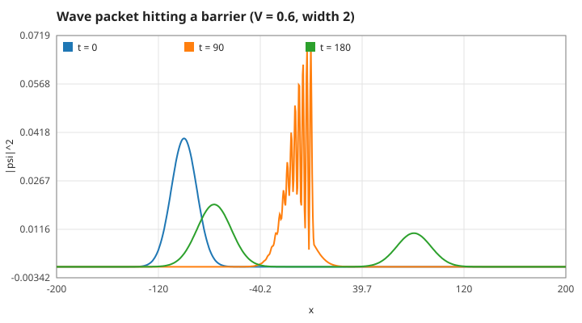
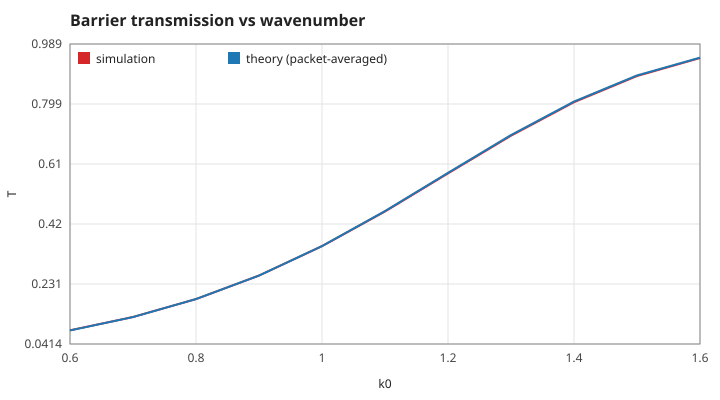

# quantum-wave-hopper

Steer a quantum wave packet at a potential barrier and tune how much tunnels through. A C11 solver for the 1D time-dependent Schrödinger equation (Crank–Nicolson, unitary) with a terminal view.
(C言語の1次元シュレーディンガー方程式ソルバ。障壁の位置と高さを操作して、トンネル透過率を確かめます。)


## Run

```sh
make && ./quantum-wave-hopper          # interactive
./quantum-wave-hopper --snapshot       # one frame, no terminal needed
./quantum-wave-hopper --gif docs/demo.gif  # scripted tunnelling run as an animated GIF
make test && make plots                # unit tests and docs/*.svg
docker build -t quantum-wave-hopper .  # same, reproducibly
```

Keys: `space` relaunch the packet, `a`/`d` move the barrier, `w`/`s` change its height, `p` pause, `q` quit. Goal: let exactly half of the packet through.

## Model

With `ħ = m = 1`: `i ∂ψ/∂t = −½ ψ'' + V ψ`. Crank–Nicolson, `(1 + iΔt H/2) ψⁿ⁺¹ = (1 − iΔt H/2) ψⁿ`, is unitary, so the norm is conserved to rounding error. The tridiagonal system is solved by the Thomas algorithm.

## Results

A packet (σ = 10, k₀ = 1) hits a barrier of height 0.6 and width 2. Simulated transmission matches the exact rectangular-barrier formula averaged over the packet's momentum spread, within 0.3 % for all k₀ in 0.6–1.6.




| k₀ | T simulated | T theory |
|----|-------------|----------|
| 0.6 | 0.0846 | 0.0844 |
| 1.0 | 0.3501 | 0.3510 |
| 1.6 | 0.9446 | 0.9457 |

## Tests

`tests/test_wave.c` checks: norm conservation (1e-10), free packet motion, spreading `σ√(1+(t/2σ²)²)` and energy, harmonic-oscillator ground state stays stationary, barrier formula limits and resonance, simulated tunnelling vs theory (5 %), renderer bounds.

## Roadmap

See the Issues: double barrier and resonant tunnelling, 2D slit interference, time-dependent potentials.

Part of a series of small C physics toys, tracked in [algo-vis-panel](https://github.com/TM-59/algo-vis-panel/issues/6). MIT licensed.
