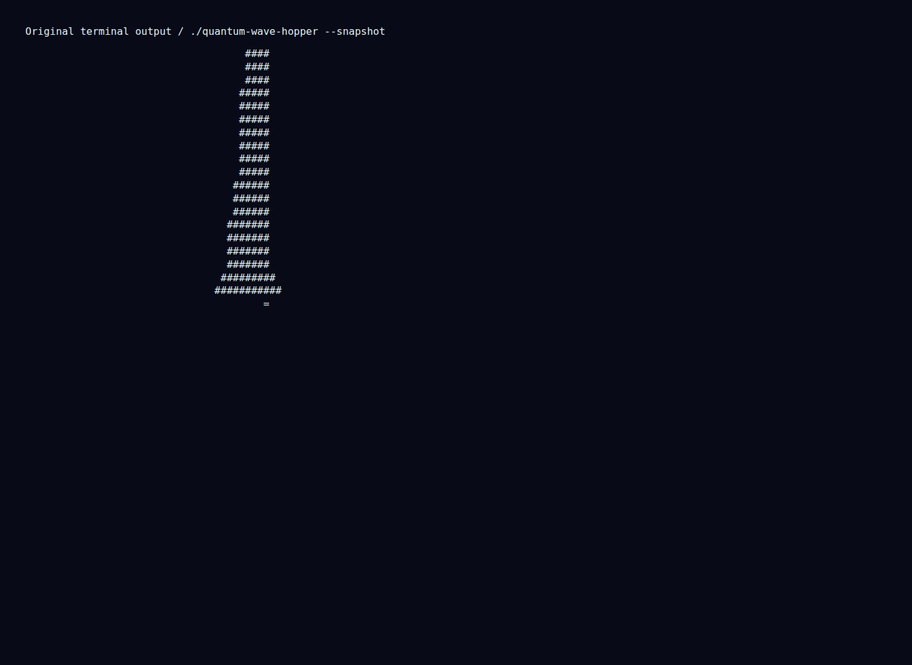
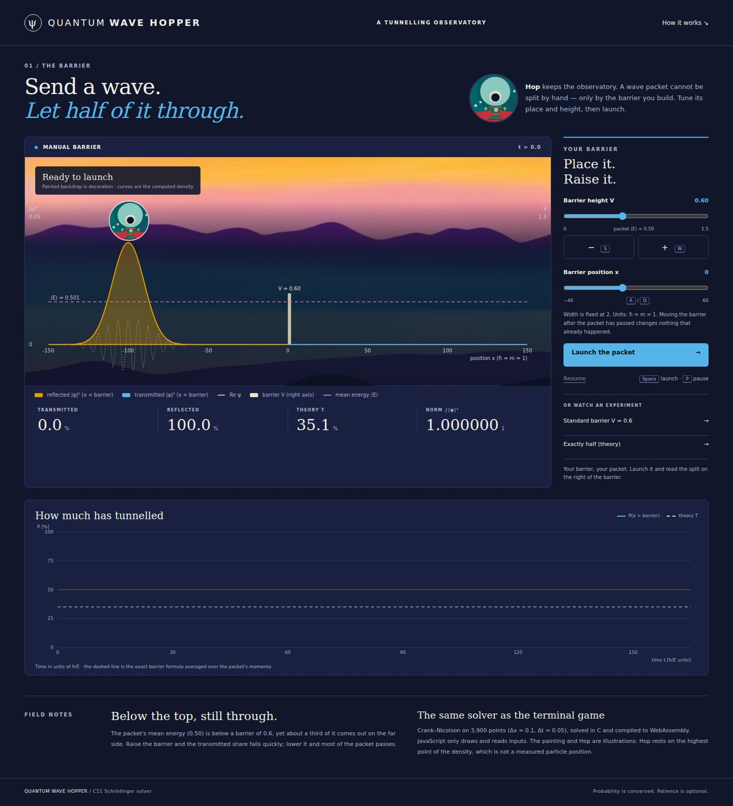
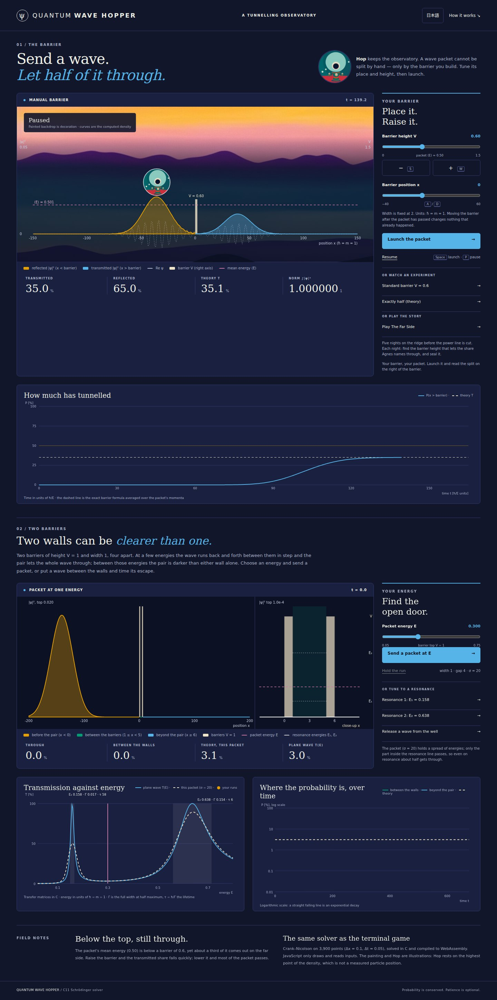
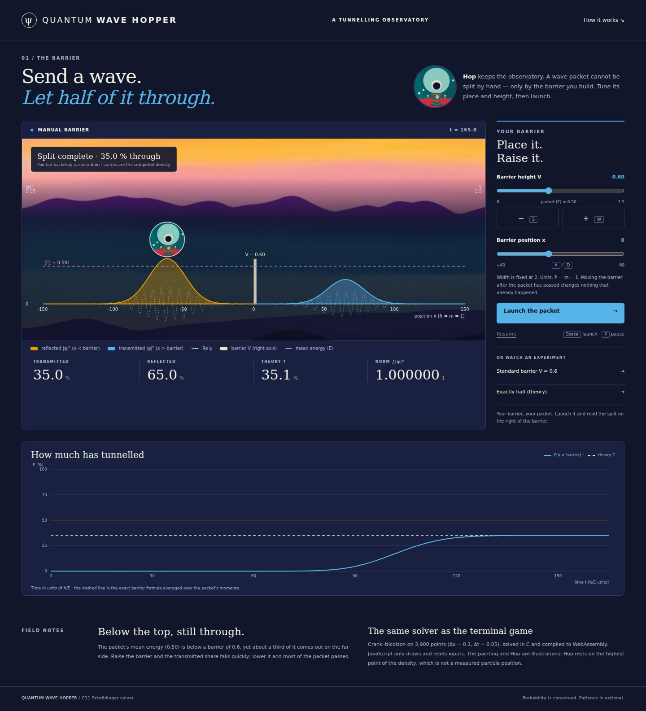
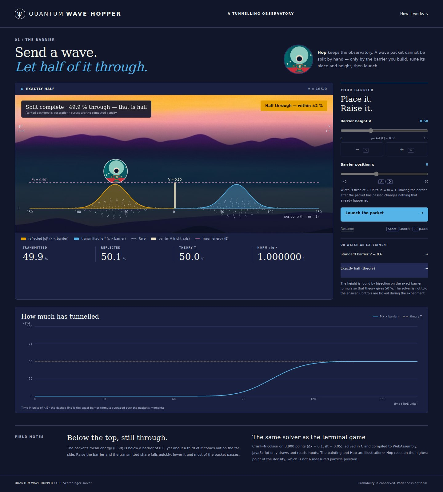
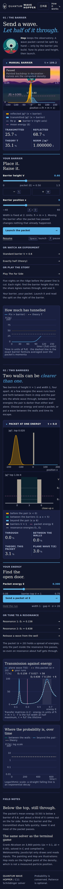
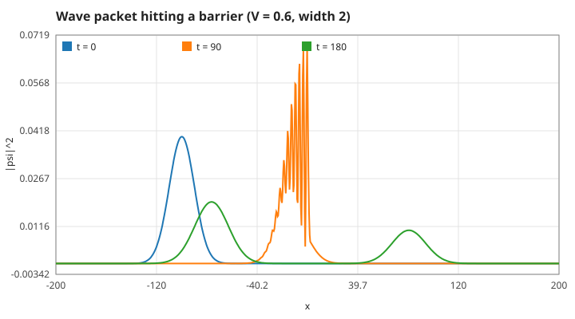
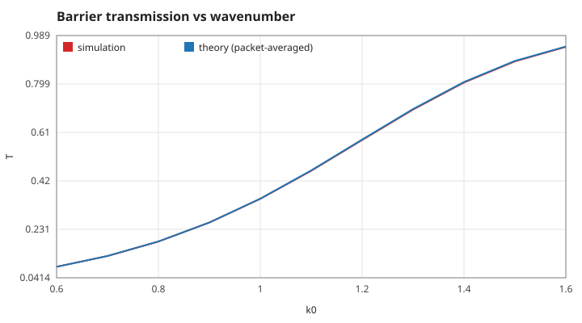

# quantum-wave-hopper

Steer a quantum wave packet at a potential barrier and tune how much tunnels through. A C11 solver for the 1D time-dependent Schrödinger equation (Crank–Nicolson, unitary) with a terminal view.
(C言語の1次元シュレーディンガー方程式ソルバ。障壁の位置と高さを操作して、トンネル透過率を確かめます。)


## Browser observatory

The same C solver, compiled to WebAssembly, drives a browser view: place and raise the barrier, launch the packet and read how the probability splits. Reflected density is orange, transmitted density is blue (colour-blind-safe Okabe–Ito pair), the barrier is read on the right-hand `V` axis and the packet's mean energy ⟨E⟩ is the dashed line. Two locked experiments show the standard barrier (V = 0.6) and the height for which the exact formula gives exactly half.

| Terminal (before) | Browser observatory (after) |
|---|---|
|  |  |






The painted backdrop and Hop, the observatory's small robot guide, are original illustrations generated locally (see [docs/art-direction.md](docs/art-direction.md)). Hop rests on the highest point of the computed density; that is decoration, not a measured particle position.

## Run

```sh
make && ./quantum-wave-hopper          # interactive
./quantum-wave-hopper --snapshot       # one frame, no terminal needed
./quantum-wave-hopper --gif docs/demo.gif  # scripted tunnelling run as an animated GIF
make test && make plots                # unit tests and docs/*.svg
docker build -t quantum-wave-hopper .  # same, reproducibly
make web && make play                  # browser observatory at http://localhost:4216 (needs emcc)
make smoke                             # native/WASM comparison, real controls, screenshots (needs Playwright)
```

Keys: `space` relaunch the packet, `a`/`d` move the barrier, `w`/`s` change its height, `p` pause, `q` quit. Goal: let exactly half of the packet through.

## Model

With `ħ = m = 1`: `i ∂ψ/∂t = −½ ψ'' + V ψ`. Crank–Nicolson, `(1 + iΔt H/2) ψⁿ⁺¹ = (1 − iΔt H/2) ψⁿ`, is unitary, so the norm is conserved to rounding error. The tridiagonal system is solved by the Thomas algorithm.

## Results

A packet (σ = 10, k₀ = 1) hits a barrier of height 0.6 and width 2. Simulated transmission matches the exact rectangular-barrier formula averaged over the packet's momentum spread, within 0.3 % for all k₀ in 0.6–1.6.




| k₀ | T simulated | T theory |
|----|-------------|----------|
| 0.6 | 0.0846 | 0.0844 |
| 1.0 | 0.3501 | 0.3510 |
| 1.6 | 0.9446 | 0.9457 |

## Tests

`tests/test_wave.c` checks: norm conservation (1e-10), free packet motion, spreading `σ√(1+(t/2σ²)²)` and energy, harmonic-oscillator ground state stays stationary, barrier formula limits and resonance, simulated tunnelling vs theory (5 %), renderer bounds.

`tests/test_observer.c` checks that the browser adapter evolves exactly the same ψ as the Wave API, conserves the norm, matches the packet-averaged theory within 1 % for V = 0.6, and that the "exactly half" height (bisection on the exact formula, V ≈ 0.5004) transmits 0.4989 in the solver. `scripts/smoke.cjs` compares WASM with the native trace (results in `docs/validation.json`).

## Roadmap

See the Issues: double barrier and resonant tunnelling, 2D slit interference, time-dependent potentials.

Part of a series of small C physics toys, tracked in [algo-vis-panel](https://github.com/TM-59/algo-vis-panel/issues/6). MIT licensed.
