# quantum-wave-hopper

Steer a quantum wave packet at a potential barrier and tune how much tunnels through. A C11 solver for the 1D time-dependent Schrödinger equation (Crank–Nicolson, unitary) with a terminal view.
(C言語の1次元シュレーディンガー方程式ソルバ。障壁の位置と高さを操作して、トンネル透過率を確かめます。)


**Theory handbook**: [docs/theory/](docs/theory/README.md) — 19 statements (the Schrödinger equation, the Gaussian packet, group velocity on a grid, the probability current, barrier transmission and tunnelling, the Crank–Nicolson scheme and its unitarity, the tridiagonal solve, accuracy, the hard walls, the program's rules, and the rules of the story layer), each with its equation, assumptions, derivation, code, tests and a figure. `make theory-figs` regenerates the figures and the measured values; `make theory-check` checks the coverage table.

(理論の手引き: 式・前提・導出・実装箇所・検査を、全項目に図つきで説明します。)

## Browser observatory

The same C solver, compiled to WebAssembly, drives a browser view: place and raise the barrier, launch the packet and read how the probability splits. Reflected density is orange, transmitted density is blue (colour-blind-safe Okabe–Ito pair), the barrier is read on the right-hand `V` axis and the packet's mean energy ⟨E⟩ is the dashed line. Two locked experiments show the standard barrier (V = 0.6) and the height for which the exact formula gives exactly half.

| Terminal (before) | Browser observatory (after) |
|---|---|
|  |  |


## The story: The Far Side

Five nights on a ridge before the power line is cut. Agnes, the observatory's last keeper, asks Hop for five calibrations of the Wall: each night a barrier height whose far-side share lands inside the band she names. Turn the dial, **fire** shots of single particles at the barrier (the counter clicks for each one found on the far side), and **seal** a setting. Every particle goes through with exactly the probability the solver computes for that height; the story never changes it, it only changes how many particles a shot sends, the battery, the hours and whether anyone reads the counter twice. A seal outside the band fails the check. Seven scenes, two choices, two endings, English and Japanese (the button in the top bar).

(物語「向こう側」: 送電線が切られるまでの五つの夜。毎晩、アグネスが言う割合だけを通す障壁の高さを探し、粒子を撃って数え、封をする。粒子が向こう側に現れる確率はソルバの値そのもので、物語はそれを変えない。)

| Dusk | A night: one shot of 60 particles | The letter |
|---|---|---|
| 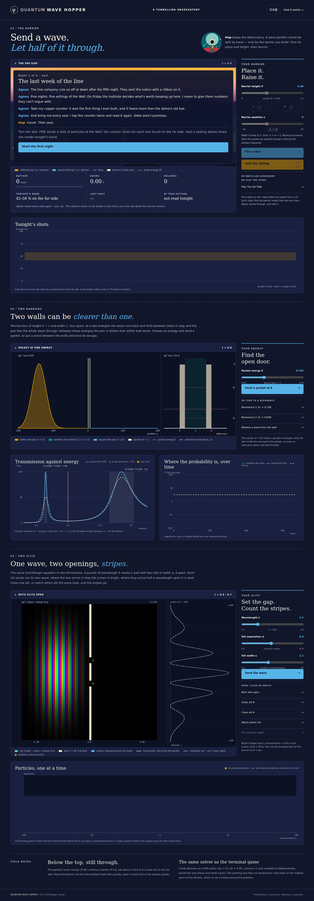 | 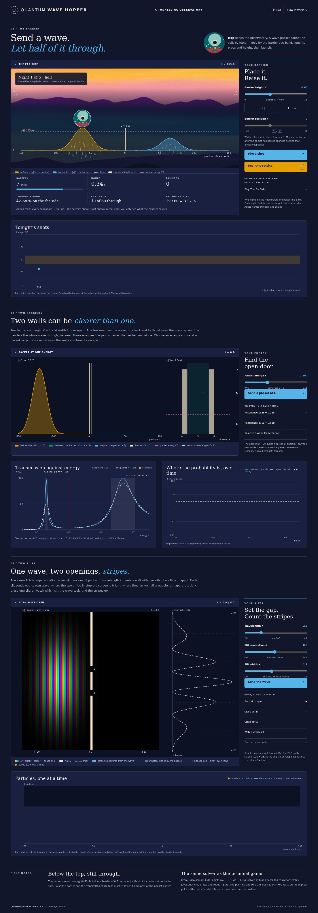 | 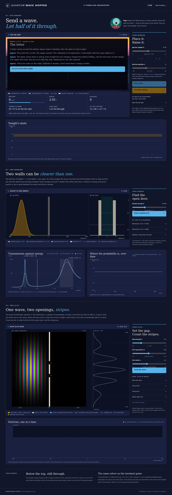 |
| **The fall** | **Dawn (the counter whole)** | **Dawn (its cells)** |
| 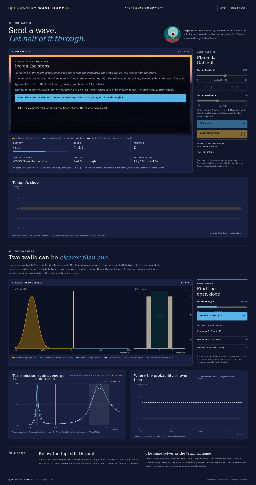 | 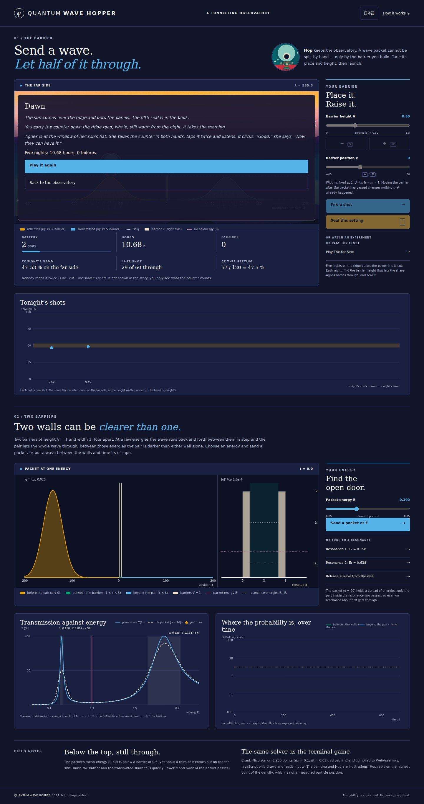 | 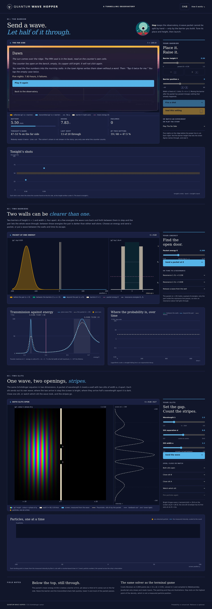 |

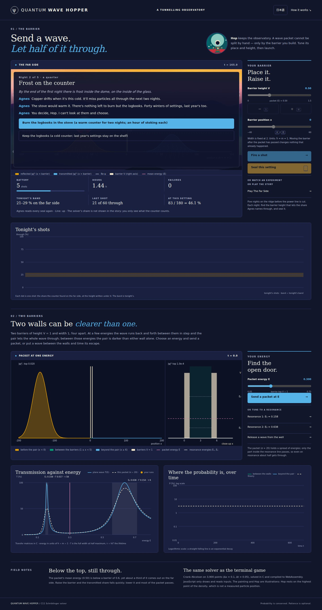
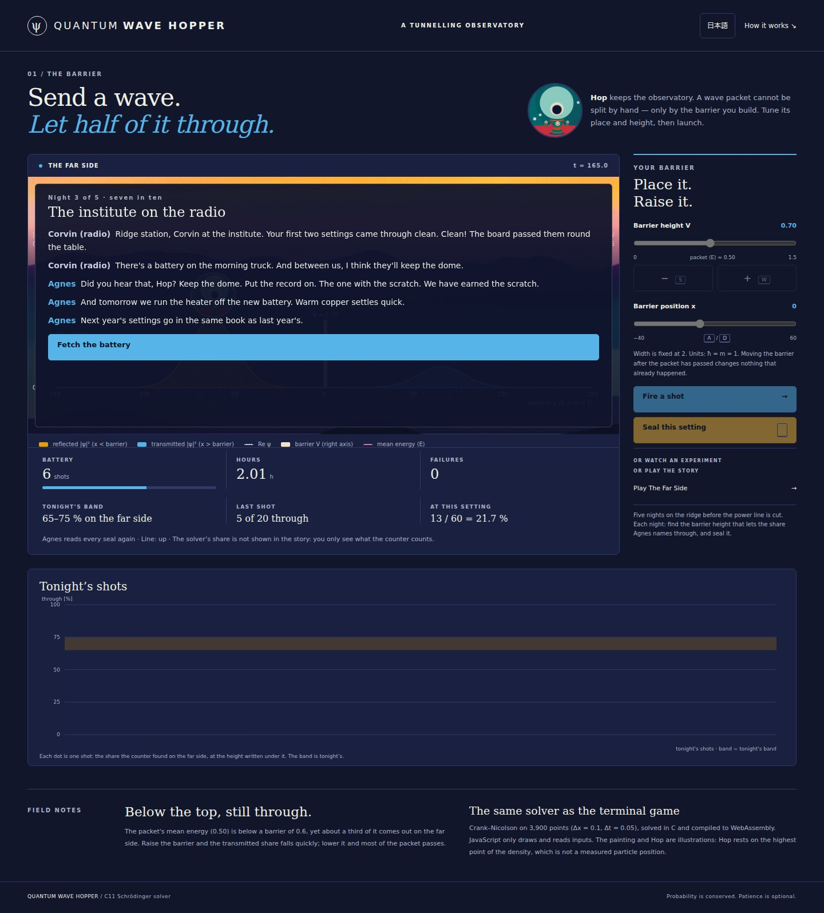
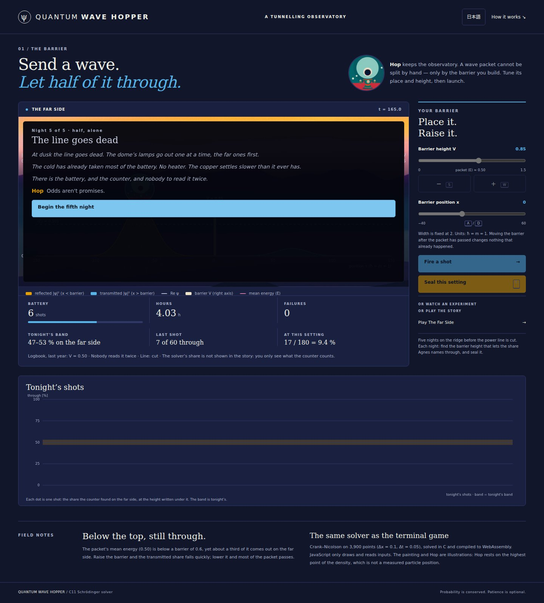
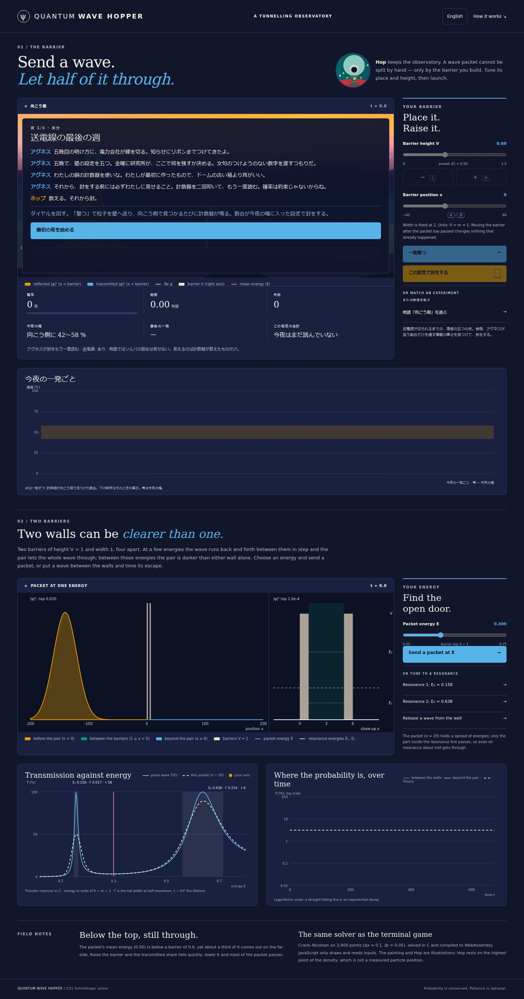
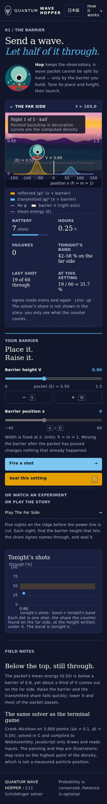

`make story` plays the five nights with a human-like operator and writes [docs/narrative/](docs/narrative/) (the order of the scenes per seed, the outcomes with story numbers on, off, one scene off and per choice path, and per-night crises over 192 runs); `make test` re-runs rows of it and requires them verbatim. The rules are page 4 of the theory handbook.

The painted backdrop and Hop, the observatory's small robot guide, are original illustrations generated locally (see [docs/art-direction.md](docs/art-direction.md)). Hop rests on the highest point of the computed density; that is decoration, not a measured particle position.

## Run

```sh
make && ./quantum-wave-hopper          # interactive
./quantum-wave-hopper --snapshot       # one frame, no terminal needed
./quantum-wave-hopper --gif docs/demo.gif  # scripted tunnelling run as an animated GIF
make test && make plots                # unit tests and docs/*.svg
docker build -t quantum-wave-hopper .  # same, reproducibly
make web && make play                  # browser observatory at http://localhost:4216 (needs emcc)
make smoke                             # native/WASM comparison, real controls, the story played to both endings, screenshots (needs Playwright)
make story && make story-check         # the story bench: regenerate docs/narrative, or compare it byte for byte
```

Keys: `space` relaunch the packet, `a`/`d` move the barrier, `w`/`s` change its height, `p` pause, `q` quit. Goal: let exactly half of the packet through. In the browser story: `w`/`s` turn the dial, `space` fires a shot, `e` seals.

## Model

With `ħ = m = 1`: `i ∂ψ/∂t = −½ ψ'' + V ψ`. Crank–Nicolson, `(1 + iΔt H/2) ψⁿ⁺¹ = (1 − iΔt H/2) ψⁿ`, is unitary, so the norm is conserved to rounding error. The tridiagonal system is solved by the Thomas algorithm.

## Results

A packet (σ = 10, k₀ = 1) hits a barrier of height 0.6 and width 2. Simulated transmission matches the exact rectangular-barrier formula averaged over the packet's momentum spread, within 0.3 % for all k₀ in 0.6–1.6.


| k₀ | T simulated | T theory |
|----|-------------|----------|
| 0.6 | 0.0846 | 0.0844 |
| 1.0 | 0.3501 | 0.3510 |
| 1.6 | 0.9446 | 0.9457 |

## Tests

`tests/test_wave.c` checks: norm conservation (1e-10), free packet motion, spreading `σ√(1+(t/2σ²)²)` and energy, harmonic-oscillator ground state stays stationary, barrier formula limits and resonance, simulated tunnelling vs theory (5 %), renderer bounds.

`tests/test_farside.c` checks the story layer: the share it uses is the Wave API's bit for bit, the counter pools to it, every scene's numbers, the scene order, quiet heavy scenes, each scene's effect and both choices.

`tests/test_observer.c` checks that the browser adapter evolves exactly the same ψ as the Wave API, conserves the norm, matches the packet-averaged theory within 1 % for V = 0.6, and that the "exactly half" height (bisection on the exact formula, V ≈ 0.5004) transmits 0.4989 in the solver. `scripts/smoke.cjs` compares WASM with the native trace (results in `docs/validation.json`).

## Roadmap

See the Issues: double barrier and resonant tunnelling, 2D slit interference, time-dependent potentials.

Part of a series of small C physics toys, tracked in [algo-vis-panel](https://github.com/TM-59/algo-vis-panel/issues/6). MIT licensed.
