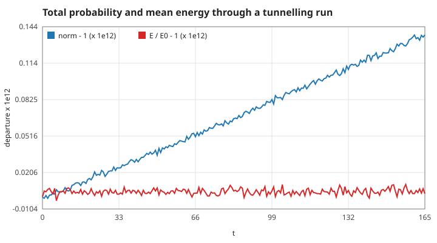
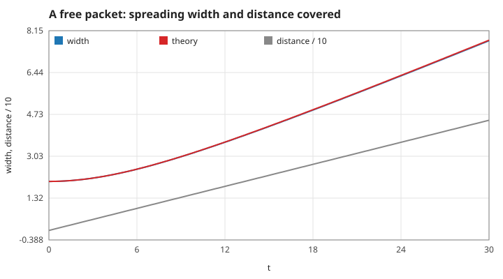
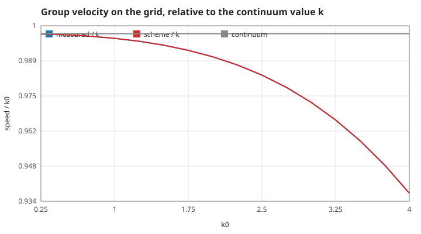
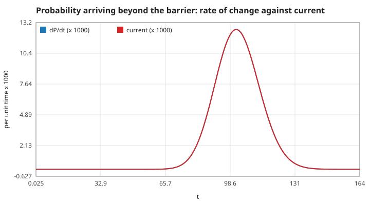
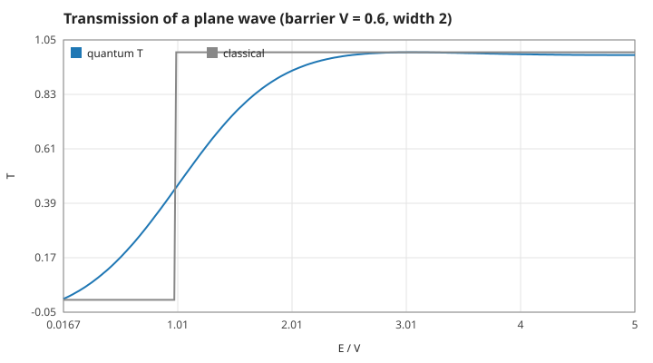
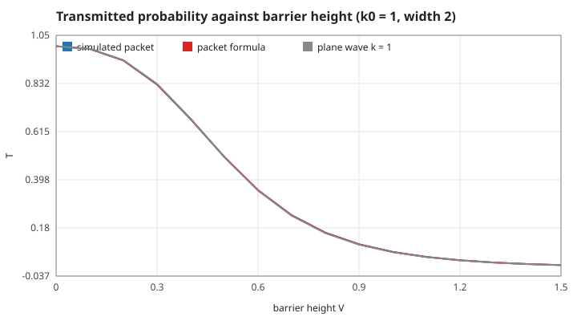

# 1. The physics: a wave packet meets a barrier

One particle on a line, in units where $\hbar = m = 1$: a wavenumber $k$ is also a momentum and a velocity, and the kinetic energy is $k^2/2$. Measured numbers are quoted by their id in [figures/values.md](figures/values.md).

[Back to the index](README.md)

## S01 — The Schrödinger equation, probability and energy

**Statement.** The wave function $\psi(x, t)$ obeys

$$i\,\frac{\partial\psi}{\partial t} = H\psi, \qquad H = -\frac12\frac{\partial^2}{\partial x^2} + V(x)$$

[Schrödinger 1926; Griffiths 2005, §1.1]. $|\psi|^2$ is the probability density (Born 1926). Because $H$ is Hermitian, the total probability $\int|\psi|^2dx$ and the mean energy $\langle H\rangle$ do not change in time.

**Assumptions and where they break.** One non-relativistic particle, a real potential that does not depend on time, no measurement during the run. On the grid, integrals are sums times $\Delta x$ and $H$ is the matrix of S07.

**Derivation.** $\frac{d}{dt}\langle\psi|\psi\rangle = i\langle H\psi|\psi\rangle - i\langle\psi|H\psi\rangle = 0$ for Hermitian $H$; the same computation with one more $H$ gives $\frac{d}{dt}\langle H\rangle = 0$.

**Code.** `wave_norm`, `wave_energy`, the static `h_psi`, and `wave_init` / `wave_free` / `wave_x` in `src/wave.c`.

**Tests.** `test_norm_is_conserved` in `tests/test_wave.c` (1e-10). Measured over the 3300 steps of the standard experiment, barrier included: `norm-drift` = 1.4e-13, `energy-drift` = 1.2e-14.

## S02 — The Gaussian wave packet: it moves and it spreads

**Statement.** The launched state is

$$\psi(x, 0) \propto \exp\left(-\frac{(x - x_0)^2}{4\sigma^2}\right)e^{ik_0(x - x_0)},$$

with position spread $\sigma$ and momentum spread $1/(2\sigma)$ — the minimum the uncertainty relation allows. In free space [Griffiths 2005, problem 2.43; Cohen-Tannoudji, Diu & Laloë 1977, compl. G-I]

$$\langle x\rangle = x_0 + k_0 t, \qquad \sigma(t) = \sigma\sqrt{1 + \left(\frac{t}{2\sigma^2}\right)^2}, \qquad \langle H\rangle = \frac{k_0^2}{2} + \frac{1}{8\sigma^2}.$$

**Assumptions and where they break.** No potential. The game's packet ($\sigma = 10$, $k_0 = 1$) barely spreads during a run: after $t = 165$ its width is 13. On the grid the centre moves slightly slower than $k_0$ (S03).

**Derivation.** In momentum space the packet is a Gaussian centred at $k_0$; each component gets the phase $e^{-ik^2t/2}$. The centre moves at the group velocity $d\omega/dk = k_0$, and the quadratic phase spreads the packet.

**Code.** `wave_gaussian` (normalises on the grid), `wave_mean_x`, `wave_variance_x` in `src/wave.c`.

**Tests.** `test_free_packet_moves_and_spreads`: centre within 0.05, width within 1 %, energy conserved to 1e-4. Measured: `packet-width-0` = 2 and `packet-norm-0` = 1 at launch; after $t = 30$ the width is `packet-width` = 7.74 against 7.76 and the centre `packet-centre` = 4.95 against 5 (the 1 % is the grid's dispersion, S03); `packet-energy`, `energy-packet`.

## S03 — Group velocity on a grid

**Statement.** On a grid of spacing $\Delta x$ advanced by the scheme of S07 with step $\Delta t$, a wave $e^{ikx}$ has energy and group velocity

$$E_h(k) = \frac{1 - \cos k\Delta x}{\Delta x^2}, \qquad v_g = \frac{\sin k\Delta x}{\Delta x}\cdot\frac{1}{1 + (E_h\Delta t/2)^2}$$

instead of $k^2/2$ and $k$. For the game ($\Delta x = 0.1$, $\Delta t = 0.05$, $k_0 = 1$) that is 0.99818: the packet runs 0.18 % slow.

**Assumptions and where they break.** A wave resolved by the grid; at $k\Delta x = \pi$ (two points per wavelength) the group velocity is zero. The game uses 63 points per wavelength.

**Derivation.** The three-point second difference applied to $e^{ikx}$ gives $E_h$. The Cayley step multiplies the mode by $(1 - iE_h\Delta t/2)/(1 + iE_h\Delta t/2) = e^{-i\omega\Delta t}$ with $\omega = (2/\Delta t)\arctan(E_h\Delta t/2)$; differentiate $\omega$ with respect to $k$.

**Code.** The property belongs to `wave_step` in `src/wave.c`.

**Tests.** `test_free_packet_moves_and_spreads` allows for it (centre within 0.05). Measured: `group-speed-k1` = 0.998162 against the scheme's 0.998178; at $k_0 = 3$ the packet moves at `group-speed-k3` = 2.9187, 2.7 % below the continuum value (`group-speed-k3-ideal`).

## S04 — Probability current: where the probability goes

**Statement.** Probability is conserved locally:

$$\frac{\partial|\psi|^2}{\partial t} + \frac{\partial j}{\partial x} = 0, \qquad j = \mathrm{Im}\left(\psi^*\frac{\partial\psi}{\partial x}\right)$$

[Griffiths 2005, problem 1.14]. The probability found beyond a point grows at exactly the rate of the current through that point. On the grid the same holds exactly, step by step, with $j_{j-1/2} = \mathrm{Im}(\bar\psi_{j-1}^*\bar\psi_j)/\Delta x$ and $\bar\psi$ the average of the old and the new wave function.

**Assumptions and where they break.** A real potential (an imaginary one would be a source or a sink). The hard walls carry no current (S11).

**Derivation.** Multiply the Schrödinger equation by $\psi^*$ and take the imaginary part. For the grid: the scheme of S07 is $\psi^{new} - \psi^{old} = -i\Delta t\,H\bar\psi$; multiplying by $\bar\psi^*$, taking real parts and summing over the sites beyond the point leaves only the hopping term across it.

**Code.** `wave_prob_right` in `src/wave.c`; the current itself is computed only in `tests/theory_figs.c`.

**Tests.** No unit test names the current. Measured: over 3300 steps the two sides of the discrete continuity equation differ by at most `continuity` = 4.7e-14, and the current added up over the run equals the probability beyond the barrier (`current-integral` = 0.350126).

## S05 — Transmission of a rectangular barrier

**Statement.** A plane wave of energy $E = k^2/2$ meets a barrier of height $V_0$ and width $w$. The transmitted fraction is [Griffiths 2005, §2.6; Landau & Lifshitz 1977, §25]

$$T = \left[1 + \frac{V_0^2\sinh^2\kappa w}{4E(V_0 - E)}\right]^{-1},\ \kappa = \sqrt{2(V_0 - E)} \quad (E < V_0), \qquad T = \left[1 + \frac{V_0^2\sin^2 qw}{4E(E - V_0)}\right]^{-1},\ q = \sqrt{2(E - V_0)} \quad (E > V_0),$$

and $T = (1 + V_0w^2/2)^{-1}$ at $E = V_0$. Below the barrier a classical particle never passes; the wave does (tunnelling), roughly as $e^{-2\kappa w}$ for a thick barrier. Above it a classical particle always passes; the wave is partly reflected, except at the resonances $qw = n\pi$.

**Assumptions and where they break.** A stationary plane wave and a perfectly sharp barrier. On the grid the barrier is 20 sites wide with edges sharp to one site.

**Derivation.** Match $\psi$ and $\psi'$ at the two edges between $e^{ikx} + re^{-ikx}$, the evanescent or oscillating solution inside, and $te^{ikx}$; $T = |t|^2$.

**Code.** `barrier_transmission` in `src/wave.c` (three branches); `wave_set_barrier` places the barrier.

**Tests.** `test_barrier_formula_limits`: no barrier gives 1 (1e-12), a thick tall barrier is opaque, a resonance gives 1 (1e-9). Measured: `barrier-game` = 0.34875 for $k = 1$ at the standard barrier ($E/V_0 = 0.83$); `barrier-at-top` = 0.4545; `barrier-resonance` = 1; the branches join continuously (`barrier-continuity` = 1e-9); `barrier-thick` matches the exponential estimate to 11 digits.

## S06 — The experiment: a packet is not a plane wave

**Statement.** A packet contains a range of momenta, each transmitted with its own $T(k)$. The fraction of the packet found beyond the barrier long after the collision is

$$T_{packet} = \frac{\int|\phi(k)|^2\,T(k)\,dk}{\int|\phi(k)|^2\,dk}, \qquad |\phi(k)|^2 \propto \exp\left(-\frac{(k - k_0)^2}{2(1/2\sigma)^2}\right).$$

The program evaluates this integral numerically and compares it with the simulated packet.

**Assumptions and where they break.** The integral runs over $k_0 \pm 6$ standard deviations in 800 steps and skips $k \le 0$; components still inside or near the barrier when the run stops are counted on neither side correctly — the run length is chosen so that nothing is left there. Grid dispersion (S03) shifts the effective energy slightly.

**Derivation.** Each momentum component scatters independently (the equation is linear), and far from the barrier the components no longer interfere in the total probability on one side.

**Code.** `packet_transmission` and `simulate_transmission` in `src/wave.c`.

**Tests.** `test_tunnelling_matches_theory`: within 5 %. Measured: `tunnel-sim` = 0.35013 against the packet formula 0.35097 (0.24 %); the packet formula differs from the single plane wave by 0.6 % (`tunnel-plane`); over 16 heights the largest gap where $T > 0.01$ is `tunnel-worst` = 0.5 %; with no barrier everything passes (`tunnel-free`).

## References

- E. Schrödinger, "Quantisierung als Eigenwertproblem", *Annalen der Physik* 79–81, 1926.
- M. Born, "Zur Quantenmechanik der Stoßvorgänge", *Zeitschrift für Physik* 37, 863–867, 1926.
- D. J. Griffiths, *Introduction to Quantum Mechanics*, 2nd ed., Pearson, 2005.
- C. Cohen-Tannoudji, B. Diu, F. Laloë, *Quantum Mechanics*, vol. 1, Wiley, 1977.
- L. D. Landau, E. M. Lifshitz, *Quantum Mechanics: Non-Relativistic Theory*, 3rd ed., Pergamon, 1977.
