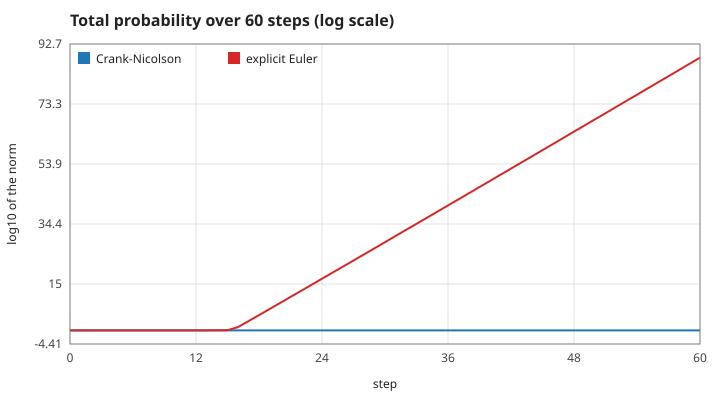
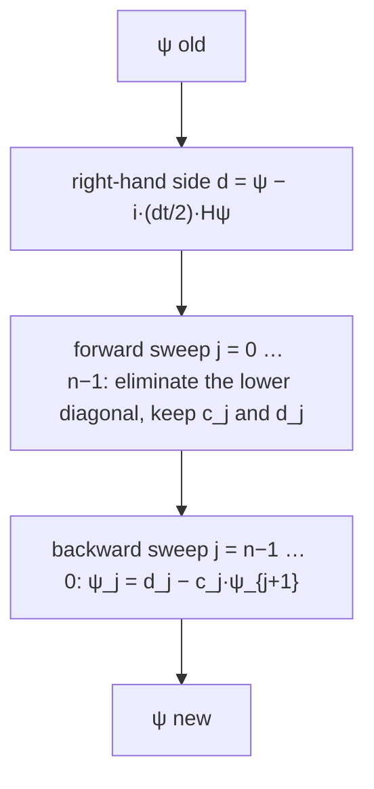
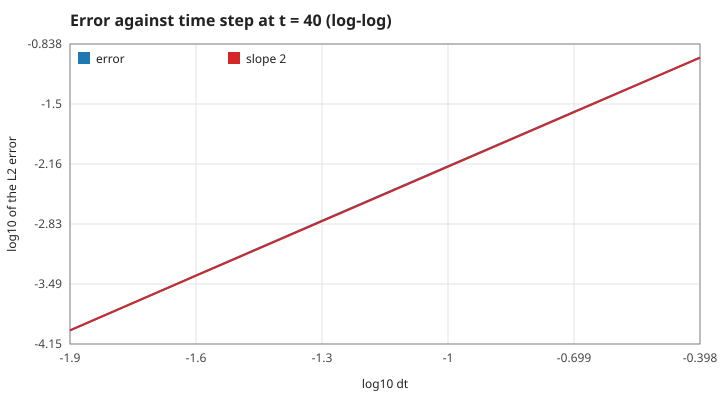
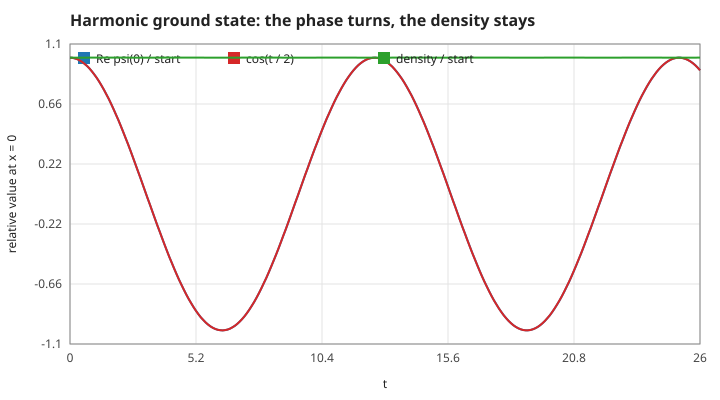
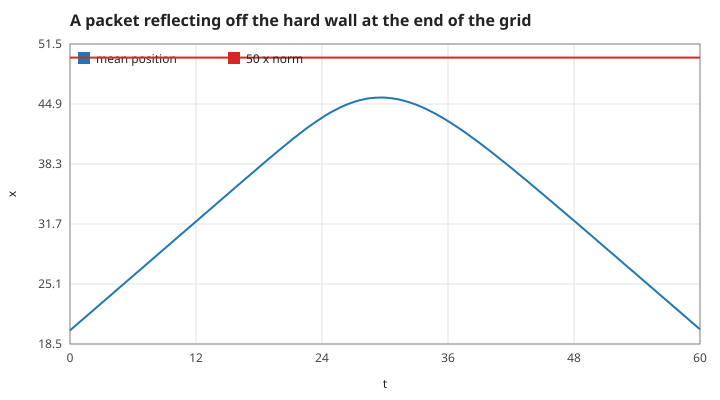

# 2. The numerical scheme: Crank–Nicolson

How the wave function is advanced, and what the scheme guarantees. Measured numbers are quoted by their id in [figures/values.md](figures/values.md).

[Back to the index](README.md)

## S07 — The Crank–Nicolson step is unitary

**Statement.** With the three-point Hamiltonian $(H\psi)_j = \left(\frac{1}{\Delta x^2} + V_j\right)\psi_j - \frac{1}{2\Delta x^2}(\psi_{j-1} + \psi_{j+1})$, one step solves

$$\left(1 + \frac{i\Delta t}{2}H\right)\psi^{new} = \left(1 - \frac{i\Delta t}{2}H\right)\psi^{old}$$

[Crank & Nicolson 1947; Goldberg, Schey & Schwartz 1967]. The step operator $U = (1 + \tfrac{i\Delta t}{2}H)^{-1}(1 - \tfrac{i\Delta t}{2}H)$ (the Cayley transform) is unitary for a Hermitian $H$ and any $\Delta t$: the total probability is conserved exactly, and so is $\langle H\rangle$.

**Assumptions and where they break.** $H$ real symmetric: a real potential and the hard walls of S11. Unitary does not mean accurate: a large $\Delta t$ keeps the norm and distorts the phases (S03, S09). An explicit step $\psi - i\Delta tH\psi$ multiplies every mode by $|1 - i\Delta tE| > 1$ and is unstable for any $\Delta t$.

**Derivation.** $H$ has real eigenvalues $E$; on each eigenvector $U$ multiplies by $(1 - i\Delta tE/2)/(1 + i\Delta tE/2)$, a number of modulus 1. $U$ commutes with $H$, so $\langle H\rangle$ is unchanged too.

**Code.** `wave_step` in `src/wave.c`: the right-hand side `psi - I * r * h_psi` with `r = dt / 2`, then the solve of S08.

**Tests.** `test_norm_is_conserved` in `tests/test_wave.c`. Measured: `cn-norm-60` = 1 to 4e-15; with a step 200 times the game's the norm is still 1 to 2e-12 (`cn-norm-big-step`); explicit Euler reaches a norm of 10 to the power `euler-norm-60` = 90.

## S08 — The tridiagonal solve

**Statement.** The matrix $1 + \tfrac{i\Delta t}{2}H$ is tridiagonal, with diagonal $b_j = 1 + \tfrac{i\Delta t}{2}\left(\tfrac{1}{\Delta x^2} + V_j\right)$ and constant off-diagonal $a = -\tfrac{i\Delta t}{4\Delta x^2}$. The Thomas algorithm solves it in one forward and one backward sweep, $O(n)$ operations [Thomas 1949; Press et al. 2007, §2.4]:

$$c_0 = \frac{a}{b_0},\ d_0 = \frac{d_0}{b_0}; \qquad m_j = b_j - a\,c_{j-1},\quad c_j = \frac{a}{m_j},\quad d_j = \frac{d_j - a\,d_{j-1}}{m_j}; \qquad \psi_{n-1} = d_{n-1},\quad \psi_j = d_j - c_j\psi_{j+1}.$$

**Assumptions and where they break.** No pivoting is done; none is needed because the matrix is strictly diagonally dominant for $V_j \ge 0$: $|b_j|^2 = 1 + \left(\tfrac{\Delta t}{2}\right)^2\left(\tfrac{1}{\Delta x^2} + V_j\right)^2 > \left(\tfrac{\Delta t}{2\Delta x^2}\right)^2 = (2|a|)^2$.

**Derivation.** Gaussian elimination restricted to the three non-zero diagonals.

**Code.** `wave_step` in `src/wave.c`; the work arrays `scratch_c` and `scratch_d` are allocated once by `wave_init`.

**Tests.** `test_norm_is_conserved` would fail if the solve were wrong. Measured: after one step on the game's grid the residual of the linear system is at most `thomas-residual` = 1.7e-16 over the 3900 sites; a step with $\Delta t$ reversed undoes a step (`step-reverse` = 1.3e-16).

## S09 — Second-order accuracy in time

**Statement.** The error of the Crank–Nicolson solution at a fixed time is proportional to $\Delta t^2$ (and, separately, to $\Delta x^2$ through the three-point Laplacian).

**Assumptions and where they break.** A wave function that the grid resolves. The error is mostly a phase error: the norm is exact at any step (S07).

**Derivation.** $(1 - iz/2)/(1 + iz/2) = e^{-iz}\left(1 + O(z^3)\right)$ with $z = E\Delta t$: the local error is third order, the accumulated one second.

**Code.** `wave_step` in `src/wave.c`. The game uses $\Delta t = 0.05$, $\Delta x = 0.1$.

**Tests.** The unit tests bound the error at one step size (`test_free_packet_moves_and_spreads`, `test_tunnelling_matches_theory`). Measured over six step sizes with the barrier present: `order-time` = 2.002; at the game's step the wave function is `error-game-dt` = 0.0016 from the reference (in the $L^2$ norm, for a state of norm 1).

## S10 — Stationary states only turn their phase

**Statement.** An eigenstate of $H$ with energy $E$ evolves as $\psi(x, t) = \psi(x, 0)\,e^{-iEt}$: its density never changes. For the harmonic oscillator $V = x^2/2$ the ground state is $\pi^{-1/4}e^{-x^2/2}$ with $E = \tfrac12$ [Griffiths 2005, §2.3].

**Assumptions and where they break.** The continuum eigenstate is not exactly an eigenvector of the grid Hamiltonian; the small admixture of other states makes the density wobble at the level measured below.

**Derivation.** Separate variables in S01.

**Code.** `wave_step` and `wave_energy` in `src/wave.c`; the test writes the potential into `w.v` directly.

**Tests.** `test_harmonic_ground_state_is_stationary`: energy within 0.001 of 1/2, density at the centre within 0.1 % after 1000 steps. Measured: `ground-energy` = 0.49992, the density changes by at most `ground-density` = 0.03 % over two periods of the phase, and the real part first crosses zero at `ground-phase` = 3.15 against $\pi$.

## S11 — The ends of the grid are hard walls

**Statement.** Outside the grid $\psi = 0$: the neighbours of the first and last site are taken as zero. The ends are perfectly reflecting walls; there is no absorbing layer. The grid is long enough that the standard experiment ends before anything reaches them.

**Assumptions and where they break.** A longer run, or a faster packet in the manual mode, would see reflections from the ends come back. The 3300-step limit of a run (S12) is what prevents it.

**Derivation.** $\psi = 0$ at the wall is the boundary condition of an infinite potential step; it keeps $H$ Hermitian, so S07 still holds.

**Code.** `h_psi` in `src/wave.c` (`j > 0 ? psi[j - 1] : 0`) and the first and last rows of the solve in `wave_step`.

**Tests.** `test_norm_is_conserved`. Measured: while reflecting, the norm never falls below `wall-norm` = 1; a mirror at 50 would return the centre to 20 at $t = 60$ and it is at `wall-return` = 20.11; in the standard demonstration the 20 bins at each end hold `demo-edges` = 4e-18 of the probability.

## References

- J. Crank, P. Nicolson, "A practical method for numerical evaluation of solutions of partial differential equations of the heat-conduction type", *Proc. Camb. Phil. Soc.* 43, 50–67, 1947.
- A. Goldberg, H. M. Schey, J. L. Schwartz, "Computer-generated motion pictures of one-dimensional quantum-mechanical transmission and reflection phenomena", *Am. J. Phys.* 35, 177–186, 1967.
- L. H. Thomas, "Elliptic problems in linear difference equations over a network", Watson Sci. Comput. Lab. Rept., Columbia University, 1949.
- W. H. Press, S. A. Teukolsky, W. T. Vetterling, B. P. Flannery, *Numerical Recipes*, 3rd ed., Cambridge University Press, 2007.
- D. J. Griffiths, *Introduction to Quantum Mechanics*, 2nd ed., Pearson, 2005.
