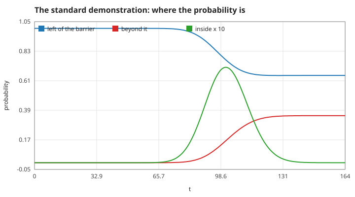
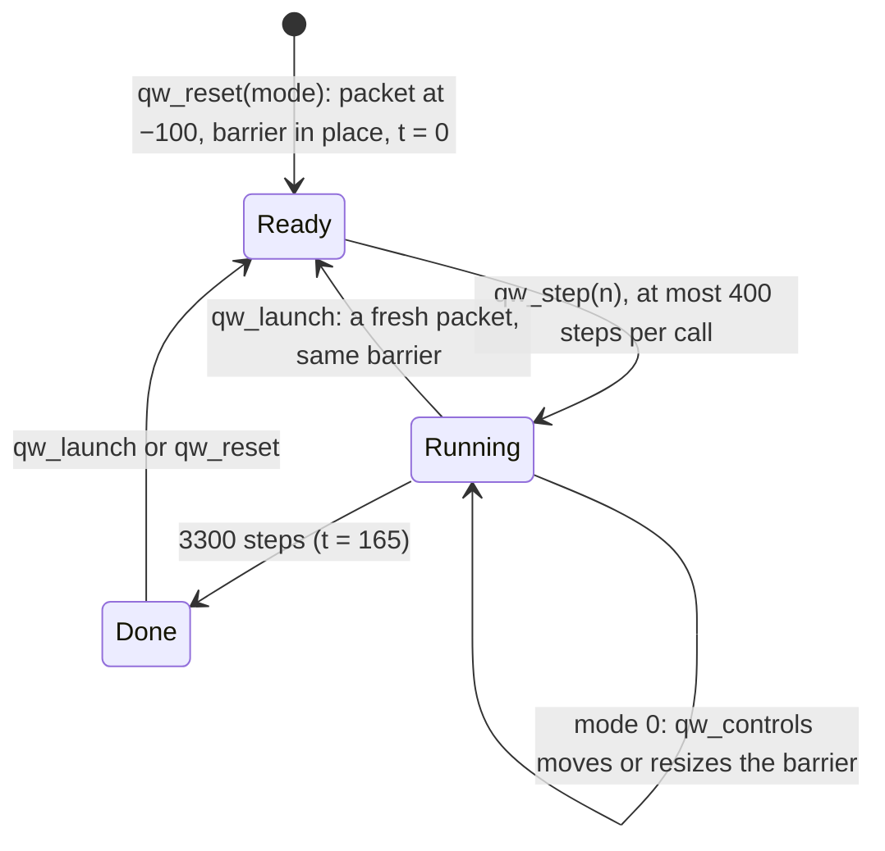
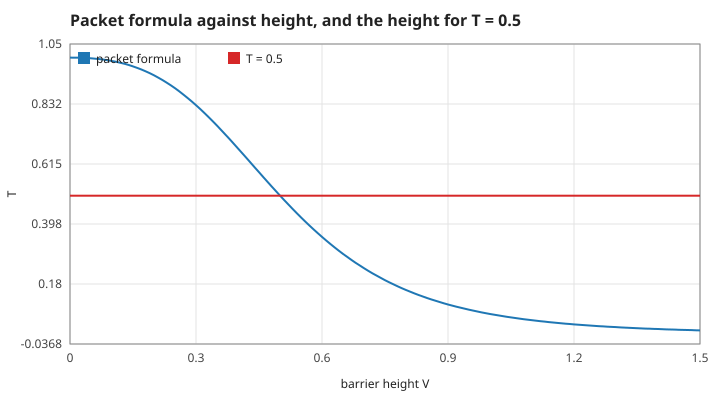
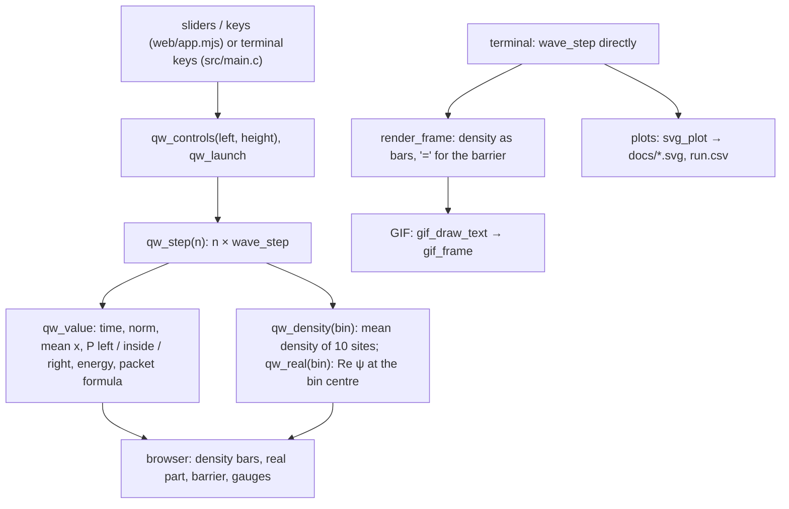

# 3. The program: the experiment on screen

The rules of the browser observatory on top of the solver. Measured numbers are quoted by their id in [figures/values.md](figures/values.md).

[Back to the index](README.md)

## S12 — The standard experiment and the three probabilities

**Statement.** Every run uses the same grid and packet: 3900 sites from $x = -195$ to 194.9 ($\Delta x = 0.1$), $\Delta t = 0.05$, a packet with $\sigma = 10$, $k_0 = 1$ launched at $x = -100$, a barrier of width 2 at `left`, and at most 3300 steps ($t = 165$). The screen shows three numbers that always add up to 1:

$$P_{left} = \sum_{x < left}|\psi|^2\Delta x, \qquad P_{inside} = \sum_{left \le x < left + 2}|\psi|^2\Delta x, \qquad P_{right} = \sum_{x \ge left + 2}|\psi|^2\Delta x,$$

and next to $P_{right}$ the packet formula of S06 for the present height.

**Assumptions and where they break.** $P_{right}$ equals the transmission only once the collision is over; mid-run it is simply how much has arrived. In the manual mode the barrier may be moved between −40 and 60 in steps of its width and its height set from 0 to 1.5; one call advances at most 400 steps.

**Derivation.** Design rules. The run length is the time for the packet to travel from −100 to well past the barrier at speed 1, short of reaching the walls (S11).

**Code.** `qw_reset`, `qw_controls`, `qw_launch`, `qw_step`, `qw_value` and the static `region` in `src/observer.c`; `QW_STEPS_PER_RUN`.

**Tests.** `tests/test_observer.c` (the adapter equals direct calls of the solver). Measured: `demo-steps` = 165; `demo-right` = 0.35013 against the formula 0.35097; the three probabilities add up to 1 within `demo-sum` = 5e-15; the controls are locked in a demonstration (`demo-locked`); `manual-left` = 14 for a request of 13.2, `manual-height` = 1.5 for 9, `manual-left-min` = −40, `manual-height-min` = 0, `manual-clamp` = 20 time units for a call of 5000 steps, `manual-launch` = 0.

## S13 — The half-through demonstration

**Statement.** Mode 2 sets the barrier to the height $V_{1/2}$ at which the packet formula gives exactly one half, $T_{packet}(V_{1/2}) = 0.5$, found by 60 bisections on $[0, 2]$: $V_{1/2} = 0.50038$. The packet's mean energy is 0.50125, so the barrier that splits the packet evenly is almost exactly as high as the packet is energetic — a classical particle of that energy would just pass.

**Assumptions and where they break.** The bisection needs $T_{packet}$ to fall monotonically with height, which holds for $k_0 = 1$, width 2 on $[0, 2]$ (the figure). The simulated packet transmits slightly less than half, by the grid dispersion of S03.

**Derivation.** Bisection halves the bracket each time: 60 halvings of 2 reach the last bit of a double.

**Code.** `qw_half_height` in `src/observer.c` (cached after the first call); `qw_reset(2)`.

**Tests.** `tests/test_observer.c`. Measured: `half-height` = 0.5 to 16 digits at `half-height-value` = 0.50038; the simulated run ends with `half-right` = 0.4989 beyond the barrier.

## S14 — From the wave function to the picture

**Statement.** The screen never draws 3900 sites. The density is shown in 390 bins of 10 sites (width 1), each the mean of $|\psi|^2$ over its sites, and the real part is sampled at each bin's centre site. Every number and every bar comes from C; JavaScript and the terminal renderer draw and collect input only. The guide character is placed at the tallest bin and is not a measured position.

**Assumptions and where they break.** The real part oscillates with wavelength $2\pi/k_0 = 6.3$, about six bins: it is drawn faithfully for $k_0 = 1$ but would alias for a much faster packet. Averaging the density over a bin loses nothing visible at this scale.

**Derivation.** A design rule: one solver, three displays.

**Code.** `qw_density`, `qw_real`, `qw_value` in `src/observer.c`; `render_frame` in `src/render.c`; `gif_open`, `gif_frame`, `gif_close`, `gif_text_size`, `gif_draw_text` in `src/gif.c`; `svg_plot` in `src/svg.c`.

**Tests.** `tests/test_observer.c`; `test_render_fits_the_screen` in `tests/test_wave.c`; `tests/test_gif.c`. Measured: the 390 displayed densities times the bin width add up to `demo-bins-area` = 1; in a fresh packet the real part half a unit from the centre is `manual-real` = 0.8777 of the amplitude, $\cos(k_0 \times 0.5)$.

## References

- The rules are this repository's: `src/observer.c`, `src/main.c`. The solver they act on is pages 1 and 2.
