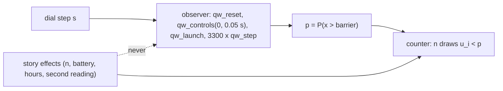
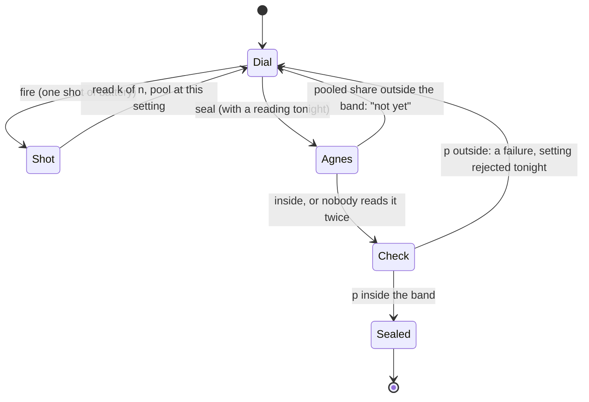
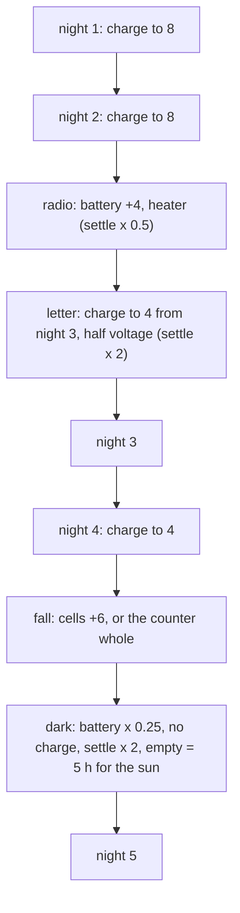
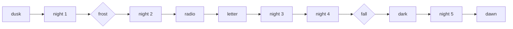
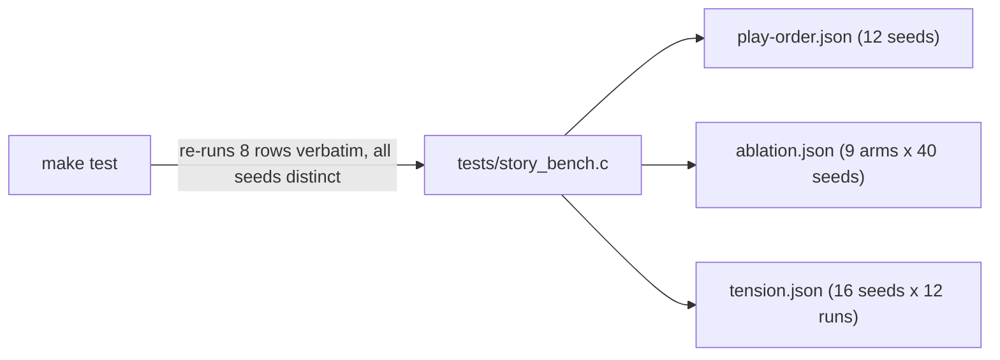

# 4. The story: The Far Side

The rules of the story layer on top of the solver: what it may change and what it may not. Numbers below are from `make story` (40 seeds per arm of the ablation, 192 runs of the tension bench) and are rewritten with it.

[Back to the index](README.md)

## S15 — The story never changes the share

**Statement.** In the story every particle is found on the far side of the barrier with probability

$$p(V) = P_{right}\ \text{after the observer's full run (S12) at height } V = 0.05\,s,\quad s = 0,\dots,30,$$

the same number the observatory computes, and the same for every story effect. A shot of $n$ particles is $n$ independent draws (Born's rule); the count $k$ is binomial, $\mathbb{E}[k] = np$, $\operatorname{sd}(k/n) = \sqrt{p(1-p)/n}$.

**Assumptions and where they break.** $p$ is the share after the collision (3300 steps), not a plane-wave formula; it carries the grid dispersion of S03. The draws are addressed by (seed, night, dial step, particle number), so two runs that reach the same setting see the same particles: the bench compares arms on common random numbers. The draws are a model of a detector, not something the solver computes.

**Derivation.** Design rule. The story calls the observer itself (reset, controls, launch, step to the end, read $P_{right}$) once per dial step and keeps the result; it never touches $\psi$, the grid or the barrier formula.

**Code.** `farside_transmission` and `farside_init` in `src/farside.c`; the draws in its static `draw` and `count`.

**Tests.** `tests/test_farside.c` `[physics]`: for dial steps 0, 5, …, 30 the story's share equals a direct Wave API run bit for bit; the observatory's standard experiment reads the same before and after story runs; the same seed and dial give the same draws with story effects on and off; 6,000 particles at $V = 0.6$ pool to $p$ within 4 standard deviations.

## S16 — A shot, a seal and the check

**Statement.** Each night $j$ names a band $[t_j - w_j,\ t_j + w_j]$ for the far-side share: (0.50, 0.08), (0.25, 0.04), (0.70, 0.05), (0.13, 0.04), (0.50, 0.03). Hop turns the dial, fires shots and seals a setting that has a reading tonight. While Agnes is in the dome she first fires one more shot of her own and pools it; if the pooled share is outside the band she says "not yet" (a crisis, not a failure). Otherwise the seal is checked against $p$: inside the band the night is sealed, outside it is a failure and that setting is rejected for the night, with the direction (too many or too few through).

**Assumptions and where they break.** Nights 3 and 5 have a single dial step inside the band, so a seal there needs enough particles: with $n = 60$ and $p = 0.50$ one shot has $\operatorname{sd} = 0.065$, more than the band's half width 0.03. A seal on a lucky reading of a wrong setting is exactly the failure the story is about ("Odds aren't promises").

**Derivation.** Particles per shot: the dome's counter 12, Agnes's copper counter 60; the frost leaves a cold counter a third of that in nights 2–3 unless the logbooks are burned; without its cells the counter hears a third in night 5.

**Code.** `farside_dial`, `farside_fire`, `farside_seal`, `farside_particles`, `farside_target`, `farside_tol`, `farside_second_reading`, `farside_value` in `src/farside.c`.

**Tests.** `tests/test_farside.c` `[mech] dusk` (60 particles and the second reading with the copper counter, 12 and none without; at $V = 0$ Agnes says not yet, without her the check fails "too many through"), `[mech] frost`, `[mech] fall`.

## S17 — Battery and hours

**Statement.** At dusk the line charges the battery up to 8 shots (never drains it); from night 3 the letter cuts that to 4, the institute's battery adds 4 on top in night 3, and in night 5 the line is cut (charge 0) after the cold has taken three quarters of what was left; the counter's cells add 6. Hours add up as

$$h_{shot} = 0.05 + 0.003\,n + 0.15\,f\,u,\qquad f = \tfrac12^{[radio,\,j=3]}\cdot 2^{[letter,\,j\ge3]}\cdot 2^{[dark,\,j=5]},$$

with $u$ a drawn settling time, 0.25 h per seal and 0.5 h more for a failed one, an hour of stoking per night in nights 2–3 if the logbooks were burned, and an empty battery costs an hour on the generator while the line stands, five hours in the dark after it is cut.

**Assumptions and where they break.** These are game numbers, not physics; they only decide how long the nights take and how often the battery runs dry. An empty battery is never a failure: failures are seals the check rejected.

**Derivation.** Design rules, set so that each scene's numbers move the outcome on almost every seed (the bench below), and the second half of the five nights is the hardest.

**Code.** `farside_charge`, `farside_settle` in `src/farside.c` and its static `start_night`.

**Tests.** `tests/test_farside.c` `[mech] radio` (4 shots more at the start of night 3), `[mech] letter` (charge 4 against 8), `[mech] dark` (no charge; an empty battery waits five hours with no failure, an hour on the generator with the line up; settling four times as slow).

## S18 — Scenes at fixed progress points, two choices, quiet heavy scenes

**Statement.** Seven scenes open at fixed points only: dusk before the first night, and the seal that ends nights 1, 2, 4 and 5 (the letter opens when the radio closes, the dark when the fall closes). Two choices change later nights: the frost (burn the logbooks or keep them) and the fall (keep the counter whole or use its cells); the second also picks the ending. The letter, the fall and the dark are heavy: they open with no banner and no "sealed" banner is raised on the way in or on the first action after.

**Assumptions and where they break.** Nothing depends on how many failures there were, so the order is the same on every path. Kept logbooks write last year's setting on the panel for nights 4 and 5; burned ones warm the counter.

**Derivation.** Design rules; the words are in `web/story.mjs` (English and Japanese).

**Code.** `farside_answer`, `farside_options`, `farside_heavy`, `farside_ending`, `farside_hint` in `src/farside.c`.

**Tests.** `tests/test_farside.c` `[order]` (12 seeds, all four paths: the seven scenes in this order, the ending follows the fall), `[quiet]` (letter, fall, dark), `[choice]`.

## S19 — The bench: does each scene matter, and is it hard enough

**Statement.** `make story` plays the five nights with an operator that reads only the panel (a hunch two steps either side of the right setting or the logbook's; pools its shots; seals within 0.7–1.6 of the band's half width, loosening with each further shot; never re-seals a rejected setting) and writes three files: the order per seed, the outcomes with all story numbers on and off, with one scene's numbers off, and with each choice fixed per path, and per-night crises and failures over 192 runs. Measured (default path, 40 seeds): all story numbers on 16.67 h and 1.12 failures, off 7.93 h and 2.62 failures; without the copper counter 2.50 failures; burning the logbooks 16.8 shots against 21.5 but 19.4 h against 16.7; the counter's cells 13.9 h against 16.7 but 24.3 shots against 21.5. Crises per night 0.38, 0.57, 0.65, 0.32, 0.85: the fourth night is the valley before the last.

**Assumptions and where they break.** The operator is a model of a careful but impatient person; a real player may read the chart better or worse. The emotional values in `docs/narrative/beats.json` are the author's and wait for someone else's review.

**Derivation.** Every run gets its own stirred seed (no XOR or sums of raw keys); paired arms share a seed on purpose, so a scene's effect is read seed by seed.

**Code.** `write_all` and `check` in `tests/story_bench.c`; `op_decide` in `tests/farside_policy.h`; `run_nights` in `tests/farside_run.h`.

**Tests.** `tests/story_bench.c` (`make test` runs `story_bench --check`: 8 re-run rows must match the files and all run seeds be distinct); `make story-check` regenerates all three files and compares them byte for byte; `tests/test_farside.c` `[beat]`, `[tension]`.
