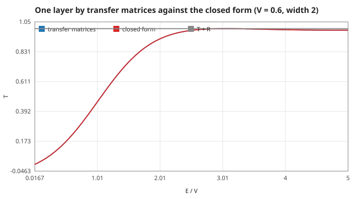
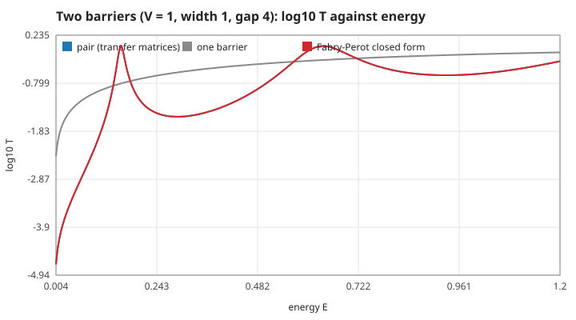
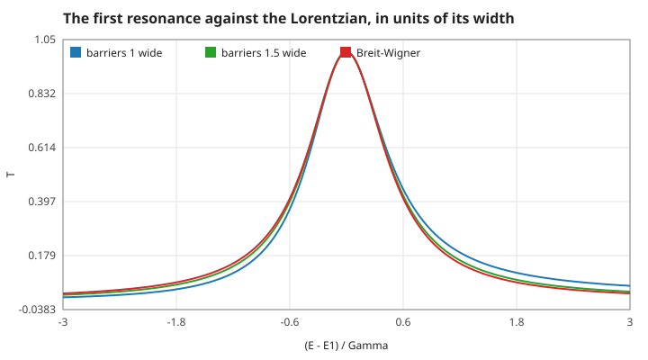
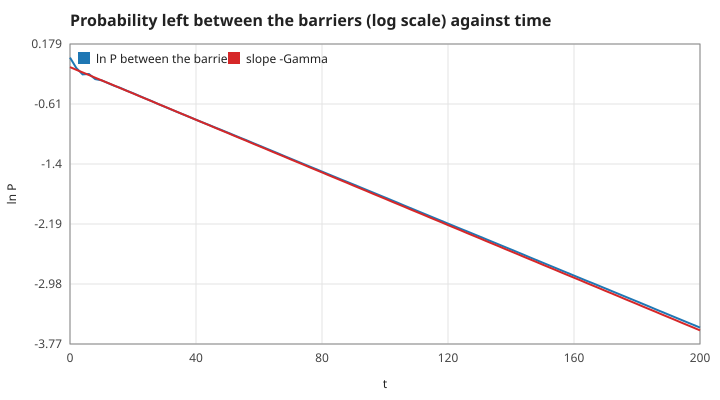
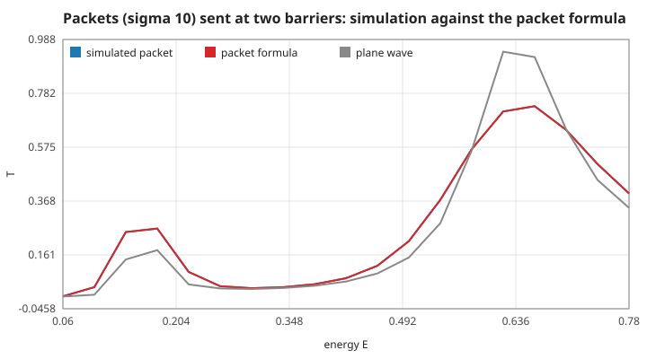
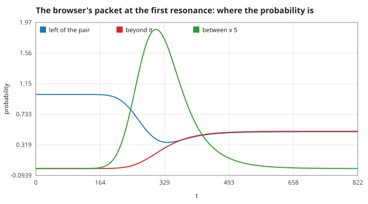
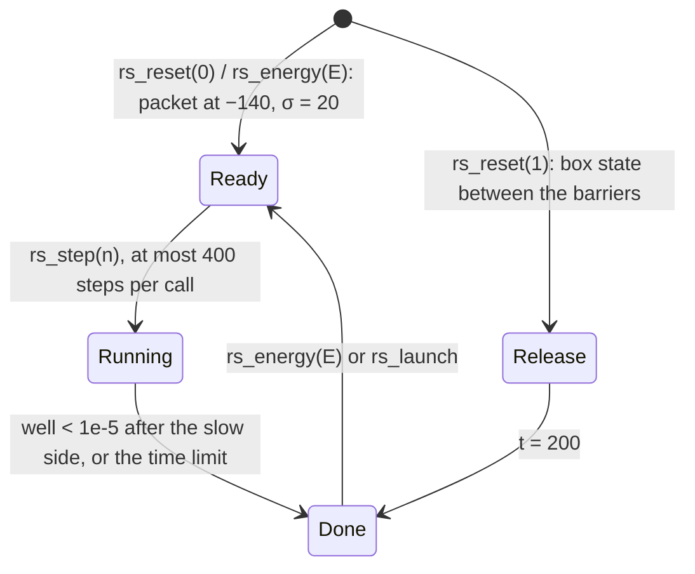

# 5. Two barriers: resonant tunnelling

Two equal barriers of height $V_0 = 1$ and width $b = 1$, a gap $L = 4$ apart: the first on $[0, 1)$, the second on $[5, 6)$. A single one of them passes about a third of a wave of energy 0.3; the pair passes 3 % — except at a few energies, where it passes everything. This page states why, how the program computes it, and how the time evolution confirms it. Units $\hbar = m = 1$; measured numbers are quoted by their id in [figures/values.md](figures/values.md).

[Back to the index](README.md)

## S20 — Transfer matrices for a potential made of steps

**Statement.** In a region of constant potential $V_i$ the solution of $-\frac12\psi'' + V_i\psi = E\psi$ is $\psi = A_ie^{iK_ix} + B_ie^{-iK_ix}$ with $K_i = \sqrt{2(E - V_i)}$ (real above the step, $i\kappa_i$ below it). Continuity of $\psi$ and $\psi'$ at an interface $x$ between regions $l$ and $r$ fixes the left amplitudes from the right ones:

$$\begin{pmatrix}A_le^{iK_lx}\\ B_le^{-iK_lx}\end{pmatrix} = \frac12\begin{pmatrix}1 + \rho & 1 - \rho\\ 1 - \rho & 1 + \rho\end{pmatrix}\begin{pmatrix}A_re^{iK_rx}\\ B_re^{-iK_rx}\end{pmatrix}, \qquad \rho = \frac{K_r}{K_l}.$$

Starting beyond the last step with $(A, B) = (1, 0)$ and multiplying through every interface gives the incoming amplitude $A_0$ and the reflected $B_0$: $T = 1/|A_0|^2$, $R = |B_0/A_0|^2$, and $T + R = 1$ [Griffiths 2005, problem 2.53; Davies 1998, §5.3].

**Assumptions and where they break.** Any number of sharp steps, $V = 0$ on both sides. At $E = V_i$ exactly the two solutions merge into $a + bx$; the code moves $K$ off zero by $1\times10^{-9}$, which costs about $1\times10^{-10}$ in $T$ there. For very thick, tall steps $e^{\kappa x}$ grows large and the product loses digits (not reached here: $\kappa x < 20$).

**Derivation.** Write the two continuity conditions as a linear system for $(A_l, B_l)$ and solve it: adding and subtracting $\psi = \ldots$ and $\psi'/(iK_l) = \ldots$ gives the matrix above. The current $j = \mathrm{Im}(\psi^*\psi')$ is the same in every region (S04), so $|A_0|^2 - |B_0|^2 = |t|^2$, i.e. $T + R = 1$.

**Code.** `layers_transmission` (with the static `local_k`) in `src/wave.c`; `double_barrier_transmission` builds the three steps barrier–well–barrier.

**Tests.** `test_layers_reduce_to_single_barrier` in `tests/test_wave.c`: one layer equals `barrier_transmission` and two barriers with no gap equal one barrier twice as wide, both to 1e-10; $T + R = 1$ for an uneven stack of five layers. Measured: `layers-single` = 1.1e-10, `layers-sum` = 4.1e-10, `layers-sum-5` = 1.5e-9, `layers-gap0` = 1.4e-10.

## S21 — Two barriers: the resonance condition

**Statement.** Let one barrier on $[0, b]$ have the transmission and reflection amplitudes $t_0, r_0$. Summing the waves that bounce $0, 1, 2, \ldots$ times between two such barriers a gap $L$ apart (a Fabry–Pérot sum) gives

$$T = \frac{|t_0|^4}{\left|1 - r_0^2e^{2ikL}\right|^2}, \qquad t_0 = \frac{e^{-ikb}}{\cosh\kappa b + i\frac{\kappa^2 - k^2}{2k\kappa}\sinh\kappa b}, \quad r_0 = \frac{-i\frac{k^2 + \kappa^2}{2k\kappa}\sinh\kappa b}{\cosh\kappa b + i\frac{\kappa^2 - k^2}{2k\kappa}\sinh\kappa b}.$$

Because $|t_0|^2 + |r_0|^2 = 1$, $T = 1$ exactly when the round-trip phase is a multiple of $2\pi$:

$$2\arg r_0 + 2kL = 2\pi n.$$

For a **symmetric** pair these resonances transmit fully even though each barrier alone reflects most of the wave; between them the pair is far more opaque than one barrier. The resonances lie below the levels $n^2\pi^2/(2L^2)$ of a box of width $L$, because the wave leaks into the walls [Bohm 1951, §11.13; Ricco & Azbel 1984].

**Assumptions and where they break.** Two identical barriers. An uneven pair ($T_a \ne T_b$) peaks at $4T_aT_b/(T_a + T_b)^2 < 1$. Plane waves of a single energy; a packet averages over the line (S24).

**Derivation.** Inside the gap the right-moving wave is $t_0$ times the sum of the round trips $\sum_m (r_0^2e^{2ikL})^m = 1/(1 - r_0^2e^{2ikL})$; the second barrier transmits it once more with $t_0$. $|1 - z|$ with $|z| = |r_0|^2$ is smallest, $1 - |r_0|^2 = |t_0|^2$, when $z$ is real and positive, which makes the numerator and the denominator equal.

**Code.** `double_barrier_transmission` (transfer matrices) and `double_barrier_resonance` (scan for the first local maximum of $T$, golden-section refinement, bisection of the two half-maximum points) in `src/wave.c`. The closed form lives only in the tests, as an independent check.

**Tests.** `test_double_barrier_matches_fabry_perot` and `test_resonances_transmit_fully` in `tests/test_wave.c`. Measured: the two computations agree to `fp-diff` = 4.1e-15 over 599 energies; resonances at `res-e1` = 0.15815 and `res-e2` = 0.63758 (below the box levels 0.308 and 1.234), with `res-t1` = `res-t2` = 1 to 15 digits; the round-trip phase there is `res-phase1` = 1.3e-9 and `res-phase2` = 9.5e-9; at $E = 0.30$ the pair passes `res-dark` = 3.0 % where one barrier passes 27.7 %; an uneven pair (widths 1 and 1.5) peaks at `res-asym` = 0.656.

## S22 — Near a resonance the line is a Breit–Wigner Lorentzian

**Statement.** Close to a resonance $E_n$,

$$T(E) \approx \frac{(\Gamma/2)^2}{(E - E_n)^2 + (\Gamma/2)^2},$$

a Lorentzian of full width at half maximum $\Gamma$ [Breit & Wigner 1936; Landau & Lifshitz 1977, §134]. The program reports $\Gamma$ as the measured width of the line, not from this formula.

**Assumptions and where they break.** The approximation is first order in $\Gamma/E_n$: the barriers' transmission and the round-trip phase are treated as constant across the line. The broad second resonance ($\Gamma_2/E_2 = 0.24$) is visibly asymmetric; thicker barriers make the line narrower and the formula better.

**Derivation.** Expand the round-trip phase to first order about $E_n$, $\phi(E) \approx 2\pi n + \phi'(E - E_n)$, in $|1 - |r_0|^2e^{i\phi}|^2 = (1 - |r_0|^2)^2 + 4|r_0|^2\sin^2(\phi/2)$; with $\sin(\phi/2) \approx \phi'(E - E_n)/2$ the line is Lorentzian with $\Gamma = 2(1 - |r_0|^2)/(|r_0|\,\phi')$.

**Code.** `double_barrier_resonance` in `src/wave.c` returns $E_n$ and $\Gamma$ (the two half-maximum points by bisection).

**Tests.** `test_breit_wigner_near_resonance` in `tests/test_wave.c`: within one width the line departs from the Lorentzian by under 0.06 for barriers 1 wide, and the gap shrinks below 0.4 of that for barriers 1.5 wide. Measured: `bw-gap-1` = 0.045 ($\Gamma/E_1 = 0.11$), `bw-gap-15` = 0.013 with `bw-width-15` = 0.0047; the gaps shrink in the ratio `bw-ratio` = 0.29 against 0.26 for $\Gamma/E_1$ — first order, as stated.

## S23 — The width is the inverse lifetime: $\tau = \hbar/\Gamma$

**Statement.** A wave put between the two barriers is a quasi-bound state: it does not stay, it leaks through both walls. The part of it that belongs to the resonance $E_n$ decays as

$$P_{between}(t) \propto e^{-\Gamma_n t/\hbar}, \qquad \tau_n = \frac{\hbar}{\Gamma_n},$$

with the same $\Gamma_n$ that is the width of the transmission line [Gamow 1928; Sakurai & Napolitano 2011, §7.8]. For the first resonance $\tau_1 = 57.7$: the wave makes about four round trips in the gap per lifetime. A rough classical estimate is the attempt rate times the chance to get out, $\Gamma \approx \hbar v\,T_1/(2L)$, which gets the order of magnitude.

**Assumptions and where they break.** The start state is the lowest standing wave of a box of width 4 between the barriers; it is mostly, not only, the first resonance: the rest leaves within the first few tens of time units (about half the probability is gone by $t = 30$), so the rate is fitted on $t \in [30, 180]$. At very long times a decaying state stops being exponential; not reached here. The leaked wave must not return from the hard walls during the run: the grid reaches $2.5t + 30$ on each side.

**Derivation.** Near the resonance the amplitude in the gap is a sum over energies with the Lorentzian weight of S22; its Fourier transform over $E$ is $e^{-iE_nt}e^{-\Gamma t/2}$, so the probability falls as $e^{-\Gamma t}$. Equivalently the resonance is a pole of the transmission amplitude at $E_n - i\Gamma/2$.

**Code.** `simulate_well_decay` and `wave_prob_between` in `src/wave.c` (the same Crank–Nicolson step as everything else, on a grid of 0.05).

**Tests.** `test_lifetime_matches_width` in `tests/test_wave.c`: the fitted decay rate equals $\Gamma_1$ within 3 %. Measured: `decay-rate` = 0.017101 against $\Gamma_1$ = 0.017321 (1.3 %), `decay-lifetime` = 58.5 against 57.7; `decay-early` = 0.52 still between the barriers at $t = 30$; the classical estimate `gamma-semiclassical` = 0.011, 36 % low.

## S24 — The packet experiment and the limits of the numbers

**Statement.** A packet of width $\sigma$ carries energies spread by about $k_0/(2\sigma)$. When that spread is wider than $\Gamma$, the packet cannot pass fully even when it is aimed at a resonance: it passes the packet average of S06,

$$T_{packet} = \frac{\int|\phi(k)|^2\,T_{pair}(k)\,dk}{\int|\phi(k)|^2\,dk},$$

which the simulated packet matches. On resonance a packet passes 31 % for $\sigma = 10$, 50 % for $\sigma = 20$ (the browser's) and 72 % for $\sigma = 40$.

**Assumptions and where they break.** The quadrature uses 6000 steps over $k_0 \pm 6$ standard deviations, finer than for one barrier because the line is narrow. The simulation must wait for the slow side of the packet ($k_0 - 3/(2\sigma)$) and for what lingers in the gap: it runs until less than $1\times10^{-6}$ is left between the barriers, at most 400 time units longer, on a grid of 0.05 wide enough that nothing reaches the walls. The grid's own dispersion (S03) shifts the resonance on the browser's grid ($\Delta x = 0.1$) by 0.03 %, a fiftieth of its width. The resonance search scans 20000 energies: a line narrower than the scan step would be missed.

**Derivation.** As in S06: the equation is linear, each momentum scatters with its own $T_{pair}(k)$, and far from the barriers the components no longer interfere in the total probability on one side.

**Code.** `double_packet_transmission`, `simulate_double_transmission` and `wave_set_double_barrier` in `src/wave.c`.

**Tests.** `test_double_barrier_packet_matches_theory` in `tests/test_wave.c` (on and off resonance within 1 %). Measured: over 19 energies the largest gap where $T > 0.01$ is `dpacket-worst` = 0.38 %; on resonance `dpacket-e1` = 0.3086 against 0.3084; `dpacket-e1-20` = 0.501 and `dpacket-e1-40` = 0.717; the $\sigma = 10$ packet's spread is `dpacket-spread` = 0.028, wider than $\Gamma_1$ = 0.017; `dpacket-grid` = 0.15811 on the grid against 0.15815.

## S25 — The two-barrier experiment on screen

**Statement.** The browser's second experiment runs the same solver on its own grid: 11000 sites from $x = -400$ to 700 ($\Delta x = 0.1$, $\Delta t = 0.05$), barriers on $[0, 1)$ and $[5, 6)$ of height 1. In the packet mode a packet of $\sigma = 20$ starts at $x = -140$ with the chosen energy $E \in [0.05, 0.75]$; the run ends when less than $1\times10^{-5}$ is left between the barriers after the slow side has passed, or at most 400 time units later, short of the walls. In the release mode the lowest box state of the gap is put between the barriers and runs to $t = 200$. The screen shows the probability before, between and beyond the pair; the plane-wave and packet transmissions for the chosen energy; the line $T(E)$ with both resonances and their widths and lifetimes; and the probability between the barriers over time on a log scale with the theory line ($T_{packet}$, or $e^{-\Gamma_1t}$ from $t = 30$).

**Assumptions and where they break.** One call advances at most 400 steps; the energy is clamped to $[0.05, 0.75]$ and a new energy starts a fresh packet. The close-up shows $|\psi|^2$ at every site of $[-3, 9)$, rescaled to its own maximum (the scale is printed). The $T(E)$ curves are 240 points between 0.02 and 0.80, computed once.

**Derivation.** Design rules on top of S20–S24. The density piles up between the barriers on resonance (37 % at its peak for $E_1$) because the wave there is the quasi-bound state of S23 being filled and emptied.

**Code.** `rs_reset`, `rs_energy`, `rs_launch`, `rs_step`, `rs_value`, `rs_density`, `rs_zoom`, `rs_curve`, `rs_curve_packet` in `src/resonance.c`; the page draws them in `web/resonance.mjs`; the terminal writes `docs/resonance.svg` and `docs/resonance.csv` with `--resonance` (`resonance` in `src/main.c`).

**Tests.** `tests/test_resonance.c` (`test_packet_on_resonance`, `test_well_release` and four more); `scripts/smoke.cjs` compares the WASM build with the native trace and drives the real buttons. Measured: `rs-right` = 0.5026 against the packet theory 0.5013, the run stops at `rs-time` = 823, `rs-well-peak` = 0.376, `rs-norm` = 7e-13; off resonance `rs-off` = 0.0512 against 0.0510; the release on the browser's coarser grid decays at `rs-release` = 0.01713 against $\Gamma_1$ (1.1 %); `rs-clamp` = 0.75.

## References

- D. Bohm, *Quantum Theory*, Prentice-Hall, 1951.
- G. Breit, E. Wigner, "Capture of slow neutrons", *Physical Review* 49, 519–531, 1936.
- J. H. Davies, *The Physics of Low-Dimensional Semiconductors*, Cambridge University Press, 1998.
- G. Gamow, "Zur Quantentheorie des Atomkernes", *Zeitschrift für Physik* 51, 204–212, 1928.
- D. J. Griffiths, *Introduction to Quantum Mechanics*, 2nd ed., Pearson, 2005.
- L. D. Landau, E. M. Lifshitz, *Quantum Mechanics: Non-Relativistic Theory*, 3rd ed., Pergamon, 1977.
- B. Ricco, M. Ya. Azbel, "Physics of resonant tunneling. The one-dimensional double-barrier case", *Physical Review B* 29, 1970–1981, 1984.
- J. J. Sakurai, J. Napolitano, *Modern Quantum Mechanics*, 2nd ed., Addison-Wesley, 2011.
