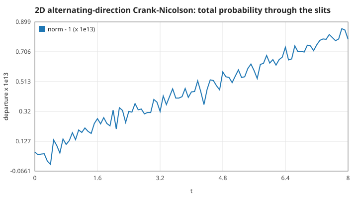
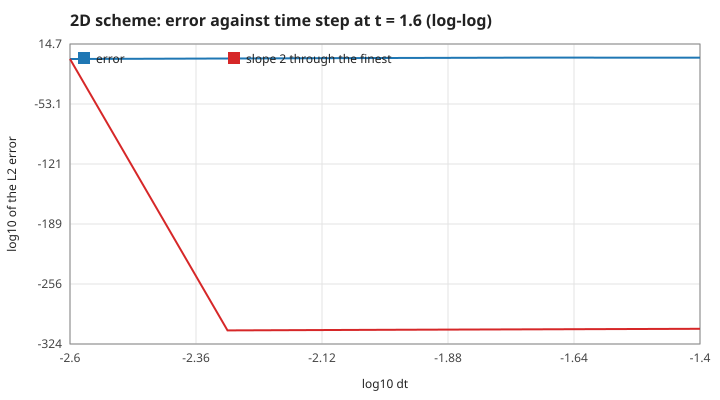
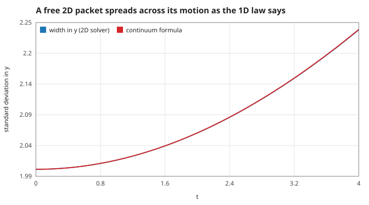
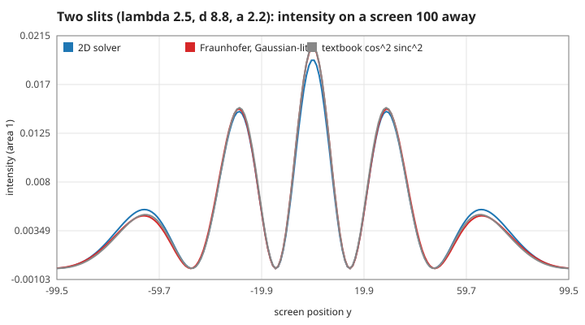
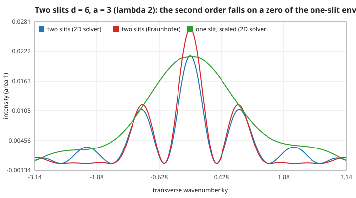
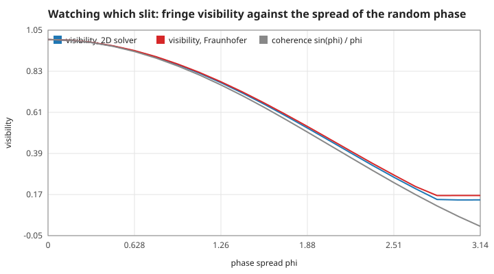
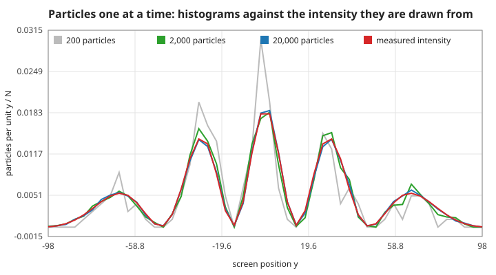
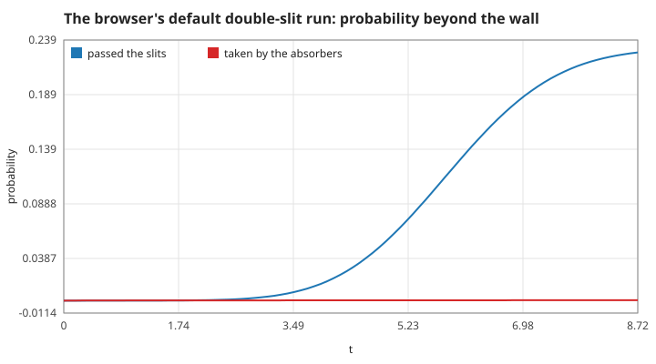
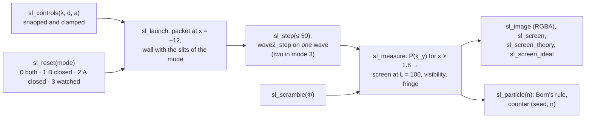

# 6. Two dimensions: the double slit

A packet of wavelength $\lambda$ runs at a wall with two slits of width $a$, a distance $d$ apart (centre to centre). Each slit sends out its own wave; on a far screen they add in step or out of step and draw bright and dark fringes. This page states the 2D scheme the program uses, why it is unitary and second order, how the far screen is computed from the wave, what Fraunhofer's formula predicts and where it fails for this wall, why watching the slits erases the fringes, and how single particles build the picture. Units $\hbar = m = 1$; measured numbers are quoted by their id in [figures/values.md](figures/values.md).

The browser's grid: 256 × 256 points, $\Delta x = \Delta y = 0.2$, $x, y \in [-25.6, 25.6)$, $\Delta t = 0.02$; wall $0.8$ thick at $x = 0$ with $V = 60$; packet $\sigma_x = 3$, $\sigma_y = 6$ from $x = -12$; default $\lambda = 2.5$, $d = 8.8$, $a = 2.2$.

[Back to the index](README.md)

## S26 — The 2D equation and an exactly unitary alternating-direction step

**Statement.** $i\,\partial_t\psi = -\frac12(\partial_x^2 + \partial_y^2)\psi + V\psi$. Split $H = A_x + A_y$ with $A_x = -\frac12\partial_x^2 + V/2$, $A_y = -\frac12\partial_y^2 + V/2$ (both Hermitian on the grid). One step is

$$\psi^{n+1} = C_x(\tfrac{\Delta t}{2})\,C_y(\Delta t)\,C_x(\tfrac{\Delta t}{2})\,\psi^n, \qquad C_a(s) = \Big(1 + \tfrac{is}{2}A_a\Big)^{-1}\Big(1 - \tfrac{is}{2}A_a\Big).$$

Each $C_a$ is the Crank–Nicolson step of S07 along one axis: a Cayley transform of a Hermitian matrix, hence unitary for any $s$, and a product of unitary matrices is unitary. So $\sum|\psi|^2\Delta x^2$ stays 1 to rounding, for any $\Delta t$ [Peaceman & Rachford 1955; Strang 1968].

**Assumptions and where they break.** Hard walls on all four sides ($\psi = 0$ outside the grid, S11). The splitting of $V$ into two halves is a choice; any split is unitary. The absorbing layers of S33 break unitarity on purpose and are switched off for this statement.

**Derivation.** $C_a(s)^\dagger C_a(s) = (1 + \tfrac{is}{2}A_a)(1 - \tfrac{is}{2}A_a)^{-1}\ldots$: the factors $(1 \pm \tfrac{is}{2}A_a)$ commute with each other because they are functions of the same matrix, so $C_a^\dagger C_a = 1$. Along a line $C_a$ needs one tridiagonal solve (S08): the step costs three sweeps of $N_xN_y$ small solves, no 2D matrix.

**Code.** `wave2_step` (with the static `cayley_line`, `sweep_x`, `sweep_y`), `wave2_init`, `wave2_free`, `wave2_x`, `wave2_y`, `wave2_norm`, `wave2_set_slits` in `src/wave2d.c`.

**Tests.** `test_unitary` in `tests/test_slits.c`: below 1e-12 over 400 steps and after 50 steps of $\Delta t = 2$. Measured: `w2-norm` = 8.6e-14, `w2-norm-big` departs by 8.8e-14.

## S27 — Second order in time, once $V\Delta t$ is small

**Statement.** The symmetric (Strang) order of the factors cancels the first-order splitting error, and each Cayley factor is second order: the global error after a fixed time falls as $\Delta t^2$. The constant contains the commutator $[A_x, A_y] = [-\frac12\partial_x^2, V/2] + [V/2, -\frac12\partial_y^2]$, large at the wall's edges where $V$ jumps by 60.

**Assumptions and where they break.** The $\Delta t^2$ law holds when $V\Delta t \ll 1$. With $V = 60$ the browser's $\Delta t = 0.02$ gives $V\Delta t = 1.2$: the wave function inside the wall (an evanescent tail) has a large time error, `w2-error-browser-dt` = 0.18 in the L2 norm after $t = 1.6$. What is shown — the far screen — comes from the wave that went through the holes, where $V = 0$; it does not move when $\Delta t$ is cut to 0.005 (the mean transverse momentum and the screen's distance to Fraunhofer agreed to three digits in that check).

**Derivation.** Each Cayley factor is $e^{-isA_a} + O(s^3)$. The Strang product $e^{-i\frac{\Delta t}{2}A_x}e^{-i\Delta tA_y}e^{-i\frac{\Delta t}{2}A_x} = e^{-i\Delta t H} + O(\Delta t^3)$ by the symmetric Baker–Campbell–Hausdorff formula; $t/\Delta t$ steps add up to $O(\Delta t^2)$.

**Code.** `wave2_step` in `src/wave2d.c`.

**Tests.** `test_second_order` in `tests/test_slits.c` (slopes between 1.85 and 2.15 for $\Delta t$ = 0.01, 0.005, 0.0025). Measured: `w2-order` = 1.999; at coarse steps the slope is not 2, `w2-order-coarse` = −0.37.

## S28 — A free 2D packet: the 1D laws on each axis

**Statement.** With $V = 0$ the two axes do not talk: a Gaussian $\psi \propto e^{-x^2/4\sigma_x^2 - y^2/4\sigma_y^2 + ik_xx}$ moves along $x$ at the grid's group velocity $\sin(k\Delta x)/\Delta x$ (S03) and spreads across its motion as in 1D, $\sigma_y(t) = \sigma_y\sqrt{1 + (t/2\sigma_y^2)^2}$ (S02). The mean energy is conserved exactly.

**Assumptions and where they break.** Free space and a grid wide enough that the packet stays away from the walls. Along $x$ the grid slows the packet (S03): at $k = 2$, $\Delta x = 0.2$ by 0.13 %. Across the motion $k_y = 0$, where the grid is most accurate.

**Derivation.** $V = 0$ makes $A_x$ and $A_y$ commute; the step becomes $C_x(\frac{\Delta t}{2})^2C_y(\Delta t)$ acting on a product $f(x)g(y)$ factor by factor, and each factor obeys the 1D results. Commuting Hermitian factors each conserve $H$, so the energy is exact.

**Code.** `wave2_gaussian`, `wave2_mean`, `wave2_variance`, `wave2_energy` in `src/wave2d.c`.

**Tests.** `test_free_packet` in `tests/test_slits.c`. Measured: `w2-width` = 2.5e-4, `w2-centre` = 7.778 against 7.788, `w2-energy` = 1.1e-15.

## S29 — The far screen is the transverse momentum; Fraunhofer's two-slit pattern

**Statement.** Once the transmitted wave is free, its distribution of transverse wavenumber $k_y$ no longer changes; far away a component of $k_y$ travels at $\sin\theta = k_y/k$ and lands on a screen at distance $L$ at $y = L\tan\theta$. So the far screen is

$$I(y) = P(k_y)\,\frac{dk_y}{dy}, \qquad P(k_y) = \int_{x \ge x_0} \Big|\frac{\Delta y}{\sqrt{2\pi}}\sum_j\psi(x, y_j)e^{-ik_yy_j}\Big|^2 dx, \qquad \frac{dk_y}{dy} = \frac{kL^2}{(y^2 + L^2)^{3/2}},$$

integrated over the part beyond the wall (Parseval: $\int P\,dk_y$ is that part's probability). Fraunhofer's approximation takes the field in the holes as the incoming one and nothing elsewhere: the far amplitude is the Fourier transform of the aperture,

$$P(k_y) \propto \Big|\int_{\text{slits}} e^{-y^2/4\sigma_y^2}e^{-ik_yy}\,dy\Big|^2 \;\xrightarrow{\ \sigma_y \to \infty\ }\; a^2\,\mathrm{sinc}^2\!\Big(\frac{k_ya}{2}\Big)\cdot 4\cos^2\!\Big(\frac{k_yd}{2}\Big).$$

Bright fringes sit at $k_y = 2\pi m/d$, i.e. $\sin\theta = m\lambda/d$, at $y_m = L\tan\arcsin(m\lambda/d)$ — for small angles every $\lambda L/d$ [Born & Wolf 1999, §8.5; Feynman, Leighton & Sands 1965, ch. 1].

**Assumptions and where they break.** The screen uses the nominal $k = 2\pi/\lambda$; the packet's spread in $k_x$ ($1/2\sigma_x = 0.17$) blurs the angle slightly. The run stops when a free packet's centre would be at $x = 9$: the transmitted wave is then beyond $x_0 = 1.8$ and has not reached the absorbers (S33). $L = 100$ is virtual (the grid ends at 25.6): the screen is computed, not simulated. At $\lambda = 2.5$, $d = 8.8$ the first fringe is at 16.5°, where $\lambda L/d$ is 4 % short of $L\tan\theta$. The incoming light is not even across the slits ($\sigma_y = 6$): that is why the comparison uses the Gaussian-lit integral; the textbook form with even light differs from it by about as much as the solver does.

**Derivation.** A free wave is a sum of plane waves $e^{i(k_xx + k_yy)}$ that keep their $k_y$; Parseval turns the sum over $y_j$ into the integral over $k_y$. With the field in the holes $u(y)$ and zero on the wall, the transverse amplitude right behind the wall is $\hat u(k_y)$; two equal holes at $\pm d/2$ give $\hat u_1(k_y)(e^{-ik_yd/2} + e^{ik_yd/2})$, which is the $\cos^2$ factor.

**Code.** `wave2_ky_spectrum`, `wave2_prob_beyond`, `slit_fraunhofer`, `slit_ideal` in `src/wave2d.c`; the mapping to the screen and the fringe measurements are `sl_measure` in `src/slits.c`.

**Tests.** `test_double_slit` and `test_fraunhofer_formulas` in `tests/test_slits.c`: five bright fringes where Fraunhofer has them (within 0.6 on the screen), the first fringe within 5 % of $L\tan\arcsin(\lambda/d)$, visibility above 0.95, L1 distance below 0.10; the quadrature with even light equals the closed form to 1e-9. Measured: `sl-spacing` = 28.67 against 29.63 (`sl-spacing-paraxial` against $\lambda L/d$ = 28.41), as a wavenumber `sl-dky` = 0.6925 against $2\pi/d$ = 0.7140 (the envelope pulls the first maximum inward); `sl-visibility` = 0.9993; `sl-l1` = 0.055 and `sl-l1-ideal` = 0.053; `sl-through` = 0.228 passed the wall, `sl-absorbed` = 4e-4.

## S30 — One slit, the missing order, and where Fraunhofer fails for a thick wall

**Statement.** One slit alone gives the envelope $\mathrm{sinc}^2(k_ya/2)$ with zeros at $k_y = 2\pi n/a$ and no fringes. With two slits the fringes live under that envelope: when $d/a$ is a whole number $m$, the $m$-th order falls on a zero and is missing. For $\lambda = 2$, $d = 6$, $a = 3$ the second order ($k_y = 2.09$) should vanish.

**Assumptions and where they break.** Fraunhofer (and Kirchhoff before it) assumes a thin screen that cuts the incoming light and nothing else. The browser's wall is 0.8 thick — a short waveguide 3 wide — and the field leaving it is not the incoming one: the missing order comes back to `missing-order` = 0.15 of the central maximum (the one-slit zero to `envelope-zero` = 0.17). Behind a wall one cell thick (0.2) the order is gone again, `missing-order-thin` = 0.013, but such a wall is not opaque: `thin-leak` = 5.4 % tunnels through it with both slits closed, against `thick-leak` = 6.5e-6 through 0.8. A second departure: the light from one off-centre slit leans toward the axis, its mean $k_y$ is `kirchhoff-lean` = 0.017 $k$ rather than 0, because more light falls on the slit's inner edge and flows in from there.

**Derivation.** For one slit $\hat u(k_y) \propto \sin(k_ya/2)/(k_y/2)$, zero at $k_ya = 2\pi n$. The two-slit orders are at $k_yd = 2\pi m$; if $d = ma$, then $k_ya = 2\pi$ there. For a thick slit the field in the hole is shaped by the walls of the channel (a waveguide whose transverse modes vanish at its sides), so $u(y)$ is not flat and its transform has no zero at $2\pi/a$.

**Code.** `wave2_set_slits` and `wave2_ky_spectrum` in `src/wave2d.c`; mode 1 and 2 of `sl_reset` in `src/slits.c`.

**Tests.** `test_single_slit` in `tests/test_slits.c` (one broad maximum, L1 below 0.10 against one lit slit, the two slits pass the same probability to 1e-6); `tests/theory_figs.c#missing-order` records the thick-wall limit. Measured: `first-order` = 0.48 against the Gaussian-lit 0.41.

## S31 — Watching which slit erases the fringes

**Statement.** Write the wave beyond the wall as the part from slit A plus the part from slit B, $\psi = \psi_A + \psi_B$. Any record of the path — here modelled as a random phase $\varphi$ added to the path through B, uniform on $[-\Phi, \Phi]$ — turns the intensity into the average

$$\langle|\psi_A + e^{i\varphi}\psi_B|^2\rangle = |\psi_A|^2 + |\psi_B|^2 + 2\gamma\,\mathrm{Re}(\psi_A^*\psi_B), \qquad \gamma = \langle e^{i\varphi}\rangle = \frac{\sin\Phi}{\Phi}.$$

At $\Phi = \pi$, $\gamma = 0$: the screen is the sum of two one-slit patterns, no fringes. The fringe visibility scales with $\gamma$ [Feynman, Leighton & Sands 1965, ch. 1; Englert 1996].

**Assumptions and where they break.** $\psi_A$ and $\psi_B$ are computed as the two runs with one slit closed; their sum stands for the two-slit wave if the wall only cuts the light — checked: `superposition` = 0.0021 (L1 between the unwatched sum and the real two-slit run). The phase model is the simplest which-path record; a real detector entangles the particle with its own state, and $\gamma$ is then the overlap of the two detector states — the same formula with another $\gamma$. Left of the wall the browser shows the mean of the two one-slit runs, which is not a wave of its own.

**Derivation.** $|\psi_A + e^{i\varphi}\psi_B|^2 = |\psi_A|^2 + |\psi_B|^2 + 2\mathrm{Re}(e^{i\varphi}\psi_A^*\psi_B)$; averaging over $\varphi$ multiplies the cross term by $\langle e^{i\varphi}\rangle = \frac{1}{2\Phi}\int_{-\Phi}^{\Phi}e^{i\varphi}d\varphi = \sin\Phi/\Phi$. In $k_y$ space the same holds with the column transforms (`wave2_ky_cross`).

**Code.** `sl_scramble` and the mode-3 branch of `sl_measure` in `src/slits.c`; `wave2_ky_cross` in `src/wave2d.c`.

**Tests.** `test_which_path` in `tests/test_slits.c`: visibility below 0.3 at $\Phi = \pi$, back above 0.95 at $\Phi = 0$, at $\Phi = \pi/2$ within 0.03 of Fraunhofer. Measured: `which-path` = 0.141 against 0.165 (what is left is the slope of the one-slit envelope), `coherence-half` = $2/\pi$ exactly, `visibility-gap` = 0.024 at most over 21 spreads.

## S32 — One particle at a time: Born's rule builds the fringes

**Statement.** A single detection lands at $y$ with probability density $I(y)$ (Born's rule). Each landing is random; the histogram of $N$ landings approaches $I(y)$ with relative errors about $1/\sqrt{N\,I\,\Delta y}$, so the fringes appear only after many particles.

**Assumptions and where they break.** The program draws the $n$-th particle by inverting the cumulative of the measured screen (linear inside each of the 200 bins) at a uniform number made from the pair (seed, $n$) by the splitmix64 mixer. The draw is a pure function of (seed, $n$, screen): it does not depend on the order of calls and never feeds back into the solver. It is a picture of the rule, not a measurement of a real detector.

**Derivation.** If $U$ is uniform on $[0, 1)$ and $F$ the cumulative of $I$, then $F^{-1}(U)$ has density $I$. The bin counts are binomial with variance $Np(1 - p)$.

**Code.** `sl_particle` and `sl_seed` in `src/slits.c`; the page draws the dots and the histogram in `web/slits.mjs`.

**Tests.** `test_particles` in `tests/test_slits.c` (40,000 particles in 20 bins within 4.5 standard deviations; the same seed gives the same particle). Measured: `born-sd` = 2.7 standard deviations at most over 50 bins for 20,000 particles; `born-repeat` = 0; `born-seed` differs.

## S33 — The limits of the box: hard walls reflect, absorbing layers do not

**Statement.** The grid is a box with hard walls (S11): a wave that reaches the edge comes back and, in the double slit, would draw false fringes. The program adds absorbing layers 4 thick on all four edges: after each step $\psi$ is multiplied by $e^{-\eta s^2\Delta t}$ with $s$ the depth into the layer (0 to 1) and $\eta = 3$. The same grid has the dispersion of S03 along each axis: at the browser's shortest wavelength ($\lambda = 2$, $k\Delta x = 0.63$) the group velocity is 6.5 % slow.

**Assumptions and where they break.** A smooth layer reflects little of what enters it; waves that graze it at a shallow angle are absorbed less. The double-slit run stops before the transmitted wave reaches the layers (`sl-absorbed` = 4e-4 is mostly the incoming packet's own tails). The layers make the step non-unitary on purpose, so the norm is no longer a check of the solver; the unitarity tests run without them.

**Derivation.** Multiplying $\psi$ by $e^{-\eta s^2\Delta t}$ after each step is, to first order in $\Delta t$, the evolution under an extra imaginary potential $-i\eta s^2$: the amplitude decays at the rate $\eta s^2$ and the probability at $2\eta s^2$ where $s > 0$. The quadratic ramp keeps the change small at the inner edge, where reflections are made.

**Code.** `wave2_absorber` and the last loop of `wave2_step` in `src/wave2d.c`.

**Tests.** `tests/theory_figs.c#absorb-layer` records the comparison; `test_double_slit` in `tests/test_slits.c` checks that the run loses under 2e-3. Measured: at $t = 20$ `absorb-hard` = 0.13 is back in the centre with hard walls, `absorb-layer` = 4.7e-6 with the layers, `absorb-norm` = 3e-5 of the packet is left on the grid.

## S34 — The double-slit experiment on screen

**Statement.** The browser's third experiment and the terminal's `--slits` output run the adapter `src/slits.c` on the grid above. The controls are snapped: $\lambda \in [2, 4]$ in steps of 0.1, $d \in [4, 14]$ in steps of 0.4, $a = 1.0 + 0.4n \le 3.8$ with at least 1.0 of wall between the slits, so that both slit edges fall between grid points. Modes: both open, slit B closed, slit A closed, and watched (the two one-slit runs side by side, with the random phase of S31). A run lasts until a free packet's centre would reach $x = 9$; the page steps 3 times per frame and measures the screen every 15 frames and at the end; then particles land 25 per frame up to 6,000.

**Assumptions and where they break.** The density image is $|\psi|^2$ raised to the power 0.35 (so the 23 % that passed stays visible) with the hue of the phase; in the watched mode it is the intensity only, the mean of the two runs left of the wall. The screen is normalised to area 1, so its height does not show how much passed the wall — the readout does.

**Derivation.** Design rules on top of S26–S33.

**Code.** `sl_reset`, `sl_controls`, `sl_scramble`, `sl_seed`, `sl_launch`, `sl_step`, `sl_measure`, `sl_value`, `sl_image`, `sl_screen`, `sl_screen_theory`, `sl_screen_ideal` in `src/slits.c`; the page draws them in `web/slits.mjs`; the terminal writes `docs/slits.svg`, `docs/slits.csv` and `docs/slits.gif` with `--slits` (`slits` in `src/main.c`).

**Tests.** `test_controls` in `tests/test_slits.c` and the mode tests above; `scripts/smoke.cjs` compares the WASM build with `./test_slits --trace` (every value to 1e-9 and the image bytes) and drives the real buttons and sliders. Measured: `sl-steps` = 436, `sl-clamp-lambda` = 4, `sl-clamp-width` = 3.0.

## References

- M. Born, E. Wolf, *Principles of Optics*, 7th ed., Cambridge University Press, 1999.
- B.-G. Englert, "Fringe visibility and which-way information: an inequality", *Physical Review Letters* 77, 2154–2157, 1996.
- R. P. Feynman, R. B. Leighton, M. Sands, *The Feynman Lectures on Physics*, vol. III, Addison-Wesley, 1965.
- D. W. Peaceman, H. H. Rachford, "The numerical solution of parabolic and elliptic differential equations", *Journal of the Society for Industrial and Applied Mathematics* 3, 28–41, 1955.
- G. Strang, "On the construction and comparison of difference schemes", *SIAM Journal on Numerical Analysis* 5, 506–517, 1968.
