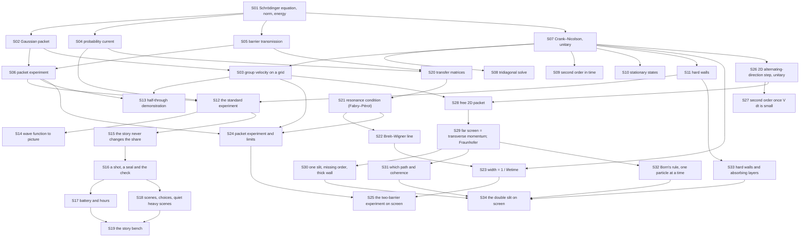

# Theory handbook

Why the program is correct, from the repository alone: every law, formula and numerical rule the code relies on, each stated in Markdown **with a figure**, the place in the code that implements it, and the test or measurement that checks it.

- Units: $\hbar = m = 1$. Grid of the game: 3900 sites, $\Delta x = 0.1$, $\Delta t = 0.05$; packet $\sigma = 10$, $k_0 = 1$; barrier width 2.
- Plotted figures and the numbers quoted in the text are produced by the program's own functions: `make theory-figs` rewrites [figures/](figures/) and [figures/values.md](figures/values.md). Diagrams are Mermaid, written in the pages.
- `make theory-check` fails when a statement has no figure, a link is broken, a referenced function or test no longer exists, or a public function is missing from the tables below.

## Pages

1. [The physics: a wave packet meets a barrier](01-quantum-mechanics.md) — the Schrödinger equation, the Gaussian packet, group velocity on a grid, the probability current, barrier transmission, the packet experiment
2. [The numerical scheme: Crank–Nicolson](02-crank-nicolson.md) — unitarity, the tridiagonal solve, second-order accuracy, stationary states, the hard walls
3. [The program: the experiment on screen](03-program.md) — the standard experiment, the half-through demonstration, from the wave function to the picture
4. [The story: The Far Side](04-story.md) — the share the story may not change, shots and seals, battery and hours, scenes and choices, the bench
5. [Two barriers: resonant tunnelling](05-double-barrier.md) — transfer matrices, the resonance condition, the Breit–Wigner line, width and lifetime, the packet experiment and its limits, the second experiment on screen
6. [Two dimensions: the double slit](06-double-slit.md) — the alternating-direction Crank–Nicolson step and its unitarity and order, free 2D packets, the far screen and Fraunhofer, one slit and the thick-wall limit, which path and coherence, Born's rule one particle at a time, absorbing layers, the third experiment on screen

## How the pieces depend on each other

## Coverage: statement → page → figure → code → test

| ID | Statement | Page | Figure | Code | Test |
|---|---|---|---|---|---|
| S01 | Schrödinger equation; probability and energy conserved | [1](01-quantum-mechanics.md) | `figures/conservation.svg` | `src/wave.c#wave_norm`, `src/wave.c#wave_energy`, `src/wave.c#wave_init`, `src/wave.c#wave_free`, `src/wave.c#wave_x` | `tests/test_wave.c#test_norm_is_conserved` |
| S02 | Gaussian packet: motion, spreading, energy | [1](01-quantum-mechanics.md) | `figures/packet.svg` | `src/wave.c#wave_gaussian`, `src/wave.c#wave_mean_x`, `src/wave.c#wave_variance_x` | `tests/test_wave.c#test_free_packet_moves_and_spreads` |
| S03 | Group velocity on the grid | [1](01-quantum-mechanics.md) | `figures/dispersion.svg` | `src/wave.c#wave_step` | `tests/theory_figs.c#group-speed-k1` |
| S04 | Probability current and continuity | [1](01-quantum-mechanics.md) | `figures/current.svg` | `src/wave.c#wave_prob_right` | `tests/theory_figs.c#continuity` |
| S05 | Rectangular-barrier transmission | [1](01-quantum-mechanics.md) | `figures/barrier.svg` | `src/wave.c#barrier_transmission`, `src/wave.c#wave_set_barrier` | `tests/test_wave.c#test_barrier_formula_limits` |
| S06 | Packet-averaged transmission and the experiment | [1](01-quantum-mechanics.md) | `figures/experiment.svg` | `src/wave.c#packet_transmission`, `src/wave.c#simulate_transmission` | `tests/test_wave.c#test_tunnelling_matches_theory` |
| S07 | Crank–Nicolson is unitary for any step | [2](02-crank-nicolson.md) | `figures/unitarity.svg` | `src/wave.c#wave_step`, `src/wave.c#h_psi` | `tests/test_wave.c#test_norm_is_conserved` |
| S08 | Thomas algorithm for the tridiagonal system | [2](02-crank-nicolson.md) | mermaid | `src/wave.c#wave_step` | `tests/theory_figs.c#thomas-residual` |
| S09 | Second-order accuracy in time | [2](02-crank-nicolson.md) | `figures/order.svg` | `src/wave.c#wave_step` | `tests/theory_figs.c#order-time` |
| S10 | Stationary states only turn their phase | [2](02-crank-nicolson.md) | `figures/stationary.svg` | `src/wave.c#wave_step` | `tests/test_wave.c#test_harmonic_ground_state_is_stationary` |
| S11 | Hard walls at the ends of the grid | [2](02-crank-nicolson.md) | `figures/walls.svg` | `src/wave.c#h_psi` | `tests/theory_figs.c#wall-norm` |
| S12 | The standard experiment; three probabilities | [3](03-program.md) | `figures/demo.svg`, mermaid | `src/observer.c#qw_reset`, `src/observer.c#qw_controls`, `src/observer.c#qw_launch`, `src/observer.c#qw_step`, `src/observer.c#qw_value` | `tests/test_observer.c#regions sum to 1` |
| S13 | The half-through demonstration | [3](03-program.md) | `figures/half.svg` | `src/observer.c#qw_half_height` | `tests/theory_figs.c#half-height` |
| S14 | From the wave function to the picture | [3](03-program.md) | mermaid | `src/observer.c#qw_density`, `src/observer.c#qw_real`, `src/render.c#render_frame` | `tests/test_observer.c#binned density identical`, `tests/test_wave.c#test_render_fits_the_screen` |
| S15 | The story never changes the share; the counter draws by Born's rule | [4](04-story.md) | mermaid | `src/farside.c#farside_transmission`, `src/farside.c#farside_init` | `tests/test_farside.c#[physics]` |
| S16 | A shot, a seal, Agnes's second reading and the check | [4](04-story.md) | mermaid | `src/farside.c#farside_dial`, `src/farside.c#farside_fire`, `src/farside.c#farside_seal`, `src/farside.c#farside_particles`, `src/farside.c#farside_target`, `src/farside.c#farside_tol`, `src/farside.c#farside_second_reading`, `src/farside.c#farside_value` | `tests/test_farside.c#[mech] dusk`, `tests/test_farside.c#[mech] frost`, `tests/test_farside.c#[mech] fall` |
| S17 | Battery and hours | [4](04-story.md) | mermaid | `src/farside.c#farside_charge`, `src/farside.c#farside_settle` | `tests/test_farside.c#[mech] radio`, `tests/test_farside.c#[mech] letter`, `tests/test_farside.c#[mech] dark` |
| S18 | Scenes at fixed progress points, two choices, quiet heavy scenes | [4](04-story.md) | mermaid | `src/farside.c#farside_answer`, `src/farside.c#farside_options`, `src/farside.c#farside_heavy`, `src/farside.c#farside_ending`, `src/farside.c#farside_hint` | `tests/test_farside.c#[order]`, `tests/test_farside.c#[quiet] letter`, `tests/test_farside.c#[choice]` |
| S19 | The story bench: each scene's effect, tension, seeds | [4](04-story.md) | mermaid | `tests/story_bench.c#write_all`, `tests/farside_policy.h#op_decide`, `tests/farside_run.h#run_nights` | `tests/story_bench.c#all run seeds distinct`, `tests/test_farside.c#[beat]` |
| S20 | Transfer matrices for a potential made of steps; T + R = 1 | [5](05-double-barrier.md) | `figures/layers.svg` | `src/wave.c#layers_transmission`, `src/wave.c#local_k`, `src/wave.c#double_barrier_transmission` | `tests/test_wave.c#test_layers_reduce_to_single_barrier` |
| S21 | Two barriers: Fabry–Pérot sum and the resonance condition | [5](05-double-barrier.md) | `figures/double.svg` | `src/wave.c#double_barrier_transmission`, `src/wave.c#double_barrier_resonance` | `tests/test_wave.c#test_double_barrier_matches_fabry_perot`, `tests/test_wave.c#test_resonances_transmit_fully` |
| S22 | Breit–Wigner line near a resonance | [5](05-double-barrier.md) | `figures/breit-wigner.svg` | `src/wave.c#double_barrier_resonance` | `tests/test_wave.c#test_breit_wigner_near_resonance` |
| S23 | Width and lifetime, τ = ħ/Γ | [5](05-double-barrier.md) | `figures/decay.svg` | `src/wave.c#simulate_well_decay`, `src/wave.c#wave_prob_between` | `tests/test_wave.c#test_lifetime_matches_width` |
| S24 | Packets at two barriers; the numerical limits | [5](05-double-barrier.md) | `figures/packet-resonance.svg` | `src/wave.c#double_packet_transmission`, `src/wave.c#simulate_double_transmission`, `src/wave.c#wave_set_double_barrier` | `tests/test_wave.c#test_double_barrier_packet_matches_theory` |
| S25 | The two-barrier experiment on screen | [5](05-double-barrier.md) | `figures/rs-demo.svg`, mermaid | `src/resonance.c#rs_reset`, `src/resonance.c#rs_energy`, `src/resonance.c#rs_launch`, `src/resonance.c#rs_step`, `src/resonance.c#rs_value`, `src/resonance.c#rs_density`, `src/resonance.c#rs_zoom`, `src/resonance.c#rs_curve`, `src/resonance.c#rs_curve_packet`, `src/main.c#resonance` | `tests/test_resonance.c#test_packet_on_resonance`, `tests/test_resonance.c#test_well_release`, `tests/test_resonance.c#test_controls_are_clamped` |
| S26 | 2D Schrödinger equation; the alternating-direction Crank–Nicolson step is unitary | [6](06-double-slit.md) | `figures/norm2d.svg` | `src/wave2d.c#wave2_step`, `src/wave2d.c#cayley_line`, `src/wave2d.c#wave2_init`, `src/wave2d.c#wave2_free`, `src/wave2d.c#wave2_x`, `src/wave2d.c#wave2_y`, `src/wave2d.c#wave2_norm`, `src/wave2d.c#wave2_set_slits` | `tests/test_slits.c#test_unitary` |
| S27 | Second order in time once V Δt is small | [6](06-double-slit.md) | `figures/order2d.svg` | `src/wave2d.c#wave2_step` | `tests/test_slits.c#test_second_order` |
| S28 | A free 2D packet follows the 1D laws on each axis | [6](06-double-slit.md) | `figures/spread2d.svg` | `src/wave2d.c#wave2_gaussian`, `src/wave2d.c#wave2_mean`, `src/wave2d.c#wave2_variance`, `src/wave2d.c#wave2_energy` | `tests/test_slits.c#test_free_packet` |
| S29 | The far screen is the transverse momentum; Fraunhofer's two-slit pattern and fringe spacing | [6](06-double-slit.md) | `figures/slits-far.svg` | `src/wave2d.c#wave2_ky_spectrum`, `src/wave2d.c#wave2_prob_beyond`, `src/wave2d.c#slit_fraunhofer`, `src/wave2d.c#slit_ideal`, `src/slits.c#sl_measure` | `tests/test_slits.c#test_double_slit`, `tests/test_slits.c#test_fraunhofer_formulas` |
| S30 | One slit, the missing order, and the thick-wall limit of Fraunhofer | [6](06-double-slit.md) | `figures/slits-one.svg` | `src/wave2d.c#wave2_set_slits`, `src/wave2d.c#wave2_ky_spectrum` | `tests/test_slits.c#test_single_slit`, `tests/theory_figs.c#missing-order` |
| S31 | Which path: a random phase multiplies the cross term by sin Φ / Φ | [6](06-double-slit.md) | `figures/coherence.svg` | `src/slits.c#sl_scramble`, `src/wave2d.c#wave2_ky_cross` | `tests/test_slits.c#test_which_path` |
| S32 | Born's rule: particles one at a time build the fringes | [6](06-double-slit.md) | `figures/born.svg` | `src/slits.c#sl_particle`, `src/slits.c#sl_seed` | `tests/test_slits.c#test_particles` |
| S33 | Hard walls reflect; absorbing layers remove; grid dispersion | [6](06-double-slit.md) | `figures/absorber.svg` | `src/wave2d.c#wave2_absorber` | `tests/theory_figs.c#absorb-layer` |
| S34 | The double-slit experiment on screen | [6](06-double-slit.md) | `figures/sl-demo.svg`, mermaid | `src/slits.c#sl_reset`, `src/slits.c#sl_controls`, `src/slits.c#sl_launch`, `src/slits.c#sl_step`, `src/slits.c#sl_value`, `src/slits.c#sl_image`, `src/slits.c#sl_screen`, `src/slits.c#sl_screen_theory`, `src/slits.c#sl_screen_ideal`, `src/main.c#slits` | `tests/test_slits.c#test_controls`, `tests/test_slits.c#test_double_slit` |

Tests named `tests/theory_figs.c#…` are measurements recorded in [figures/values.md](figures/values.md) by `make theory-figs`, not assertions of `make test`. S03, S04, S08, S09, S11, S13 and S33 are covered only that way (S30 partly); turning them into assertions is a follow-up.

What the measurements made visible (none of it is changed here):

- **The grid slows the packet**: at $k_0 = 1$ by 0.18 %, at $k_0 = 3$ by 2.7 % (S03). This is why the simulated transmission sits 0.24 % under the packet formula and the half-through run ends at 0.4989.
- **The ends of the grid reflect** (S11); the run length keeps the packet away from them.
- **The 2D step's time error is large inside the slit wall** (V Δt = 1.2 at the browser's step, S27), but the far screen comes from where V = 0 and does not move when Δt is cut by 4.
- **A wall 0.8 thick is not Fraunhofer's thin screen** (S30): a missing order comes back to 15 % of the centre; a one-cell wall removes it but lets 5 % tunnel through.

## Public functions that state no law

| Function | What it is |
|---|---|
| `src/svg.c#svg_plot` | writes the line charts of this handbook and of `make plots` |
| `src/gif.c#gif_open`, `src/gif.c#gif_frame`, `src/gif.c#gif_close`, `src/gif.c#gif_text_size`, `src/gif.c#gif_draw_text` | GIF89a/LZW encoder for the demo animation |

## Reading the source against this table

Functions reviewed for this handbook: every declaration in `src/wave.h`, `src/observer.h`, `src/resonance.h`, `src/wave2d.h`, `src/slits.h`, `src/farside.h`, `src/render.h`, `src/svg.h` and `src/gif.h`; the static helpers `h_psi` in `src/wave.c` and `region` in `src/observer.c`; `headless` in `src/main.c`.

The solver and the program are unchanged by this handbook: it adds `tests/theory_figs.c`, `scripts/theory-check.py`, two Makefile targets and these pages. Page 4 was added with the story layer (`src/farside.c`), which leaves the solver unchanged too. Page 5 was added with the two-barrier experiment: it adds functions to `src/wave.c` and the adapter `src/resonance.c`, and leaves the existing functions, outputs and figures byte for byte unchanged. Page 6 was added with the double slit: a separate 2D solver `src/wave2d.c` and the adapter `src/slits.c`; the 1D solver, its outputs and the earlier figures are unchanged byte for byte.
