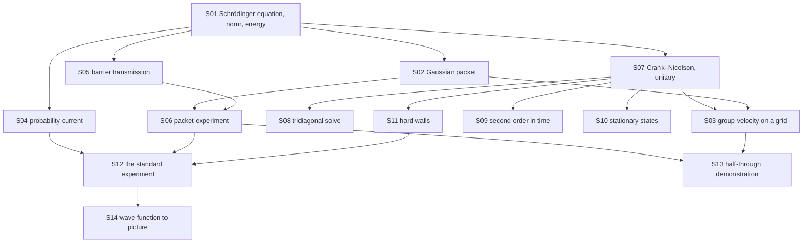

# Theory handbook

Why the program is correct, from the repository alone: every law, formula and numerical rule the code relies on, each stated in Markdown **with a figure**, the place in the code that implements it, and the test or measurement that checks it.

- Units: $\hbar = m = 1$. Grid of the game: 3900 sites, $\Delta x = 0.1$, $\Delta t = 0.05$; packet $\sigma = 10$, $k_0 = 1$; barrier width 2.
- Plotted figures and the numbers quoted in the text are produced by the program's own functions: `make theory-figs` rewrites [figures/](figures/) and [figures/values.md](figures/values.md). Diagrams are Mermaid, written in the pages.
- `make theory-check` fails when a statement has no figure, a link is broken, a referenced function or test no longer exists, or a public function is missing from the tables below.

## Pages

1. [The physics: a wave packet meets a barrier](01-quantum-mechanics.md) — the Schrödinger equation, the Gaussian packet, group velocity on a grid, the probability current, barrier transmission, the packet experiment
2. [The numerical scheme: Crank–Nicolson](02-crank-nicolson.md) — unitarity, the tridiagonal solve, second-order accuracy, stationary states, the hard walls
3. [The program: the experiment on screen](03-program.md) — the standard experiment, the half-through demonstration, from the wave function to the picture

## How the pieces depend on each other

## Coverage: statement → page → figure → code → test

| ID | Statement | Page | Figure | Code | Test |
|---|---|---|---|---|---|
| S01 | Schrödinger equation; probability and energy conserved | [1](01-quantum-mechanics.md) | `figures/conservation.svg` | `src/wave.c#wave_norm`, `src/wave.c#wave_energy`, `src/wave.c#wave_init`, `src/wave.c#wave_free`, `src/wave.c#wave_x` | `tests/test_wave.c#test_norm_is_conserved` |
| S02 | Gaussian packet: motion, spreading, energy | [1](01-quantum-mechanics.md) | `figures/packet.svg` | `src/wave.c#wave_gaussian`, `src/wave.c#wave_mean_x`, `src/wave.c#wave_variance_x` | `tests/test_wave.c#test_free_packet_moves_and_spreads` |
| S03 | Group velocity on the grid | [1](01-quantum-mechanics.md) | `figures/dispersion.svg` | `src/wave.c#wave_step` | `tests/theory_figs.c#group-speed-k1` |
| S04 | Probability current and continuity | [1](01-quantum-mechanics.md) | `figures/current.svg` | `src/wave.c#wave_prob_right` | `tests/theory_figs.c#continuity` |
| S05 | Rectangular-barrier transmission | [1](01-quantum-mechanics.md) | `figures/barrier.svg` | `src/wave.c#barrier_transmission`, `src/wave.c#wave_set_barrier` | `tests/test_wave.c#test_barrier_formula_limits` |
| S06 | Packet-averaged transmission and the experiment | [1](01-quantum-mechanics.md) | `figures/experiment.svg` | `src/wave.c#packet_transmission`, `src/wave.c#simulate_transmission` | `tests/test_wave.c#test_tunnelling_matches_theory` |
| S07 | Crank–Nicolson is unitary for any step | [2](02-crank-nicolson.md) | `figures/unitarity.svg` | `src/wave.c#wave_step`, `src/wave.c#h_psi` | `tests/test_wave.c#test_norm_is_conserved` |
| S08 | Thomas algorithm for the tridiagonal system | [2](02-crank-nicolson.md) | mermaid | `src/wave.c#wave_step` | `tests/theory_figs.c#thomas-residual` |
| S09 | Second-order accuracy in time | [2](02-crank-nicolson.md) | `figures/order.svg` | `src/wave.c#wave_step` | `tests/theory_figs.c#order-time` |
| S10 | Stationary states only turn their phase | [2](02-crank-nicolson.md) | `figures/stationary.svg` | `src/wave.c#wave_step` | `tests/test_wave.c#test_harmonic_ground_state_is_stationary` |
| S11 | Hard walls at the ends of the grid | [2](02-crank-nicolson.md) | `figures/walls.svg` | `src/wave.c#h_psi` | `tests/theory_figs.c#wall-norm` |
| S12 | The standard experiment; three probabilities | [3](03-program.md) | `figures/demo.svg`, mermaid | `src/observer.c#qw_reset`, `src/observer.c#qw_controls`, `src/observer.c#qw_launch`, `src/observer.c#qw_step`, `src/observer.c#qw_value` | `tests/test_observer.c#regions sum to 1` |
| S13 | The half-through demonstration | [3](03-program.md) | `figures/half.svg` | `src/observer.c#qw_half_height` | `tests/theory_figs.c#half-height` |
| S14 | From the wave function to the picture | [3](03-program.md) | mermaid | `src/observer.c#qw_density`, `src/observer.c#qw_real`, `src/render.c#render_frame` | `tests/test_observer.c#binned density identical`, `tests/test_wave.c#test_render_fits_the_screen` |

Tests named `tests/theory_figs.c#…` are measurements recorded in [figures/values.md](figures/values.md) by `make theory-figs`, not assertions of `make test`. S03, S04, S08, S09, S11 and S13 are covered only that way; turning them into assertions is a follow-up.

What the measurements made visible (none of it is changed here):

- **The grid slows the packet**: at $k_0 = 1$ by 0.18 %, at $k_0 = 3$ by 2.7 % (S03). This is why the simulated transmission sits 0.24 % under the packet formula and the half-through run ends at 0.4989.
- **The ends of the grid reflect** (S11); the run length keeps the packet away from them.

## Public functions that state no law

| Function | What it is |
|---|---|
| `src/svg.c#svg_plot` | writes the line charts of this handbook and of `make plots` |
| `src/gif.c#gif_open`, `src/gif.c#gif_frame`, `src/gif.c#gif_close`, `src/gif.c#gif_text_size`, `src/gif.c#gif_draw_text` | GIF89a/LZW encoder for the demo animation |

## Reading the source against this table

Functions reviewed for this handbook: every declaration in `src/wave.h`, `src/observer.h`, `src/render.h`, `src/svg.h` and `src/gif.h`; the static helpers `h_psi` in `src/wave.c` and `region` in `src/observer.c`; `headless` in `src/main.c`.

The solver and the program are unchanged by this handbook: it adds `tests/theory_figs.c`, `scripts/theory-check.py`, two Makefile targets and these pages.
